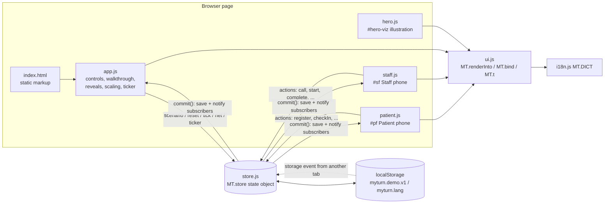
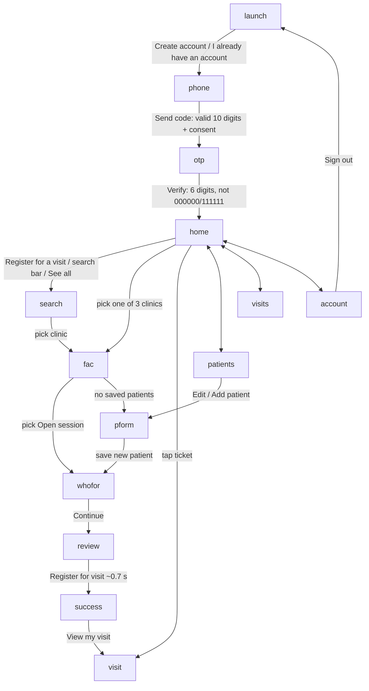
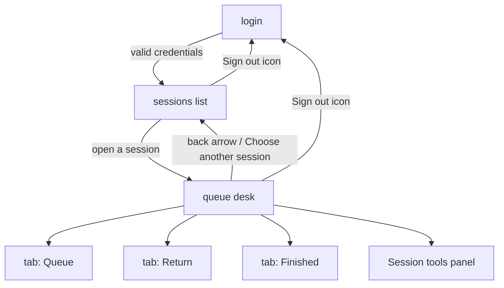
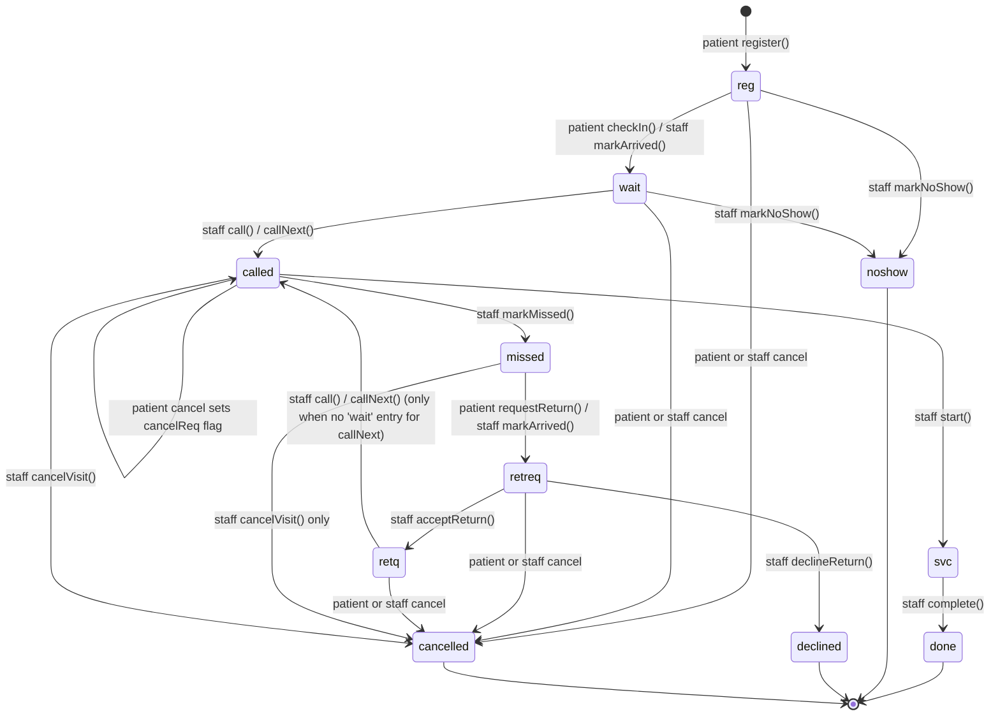
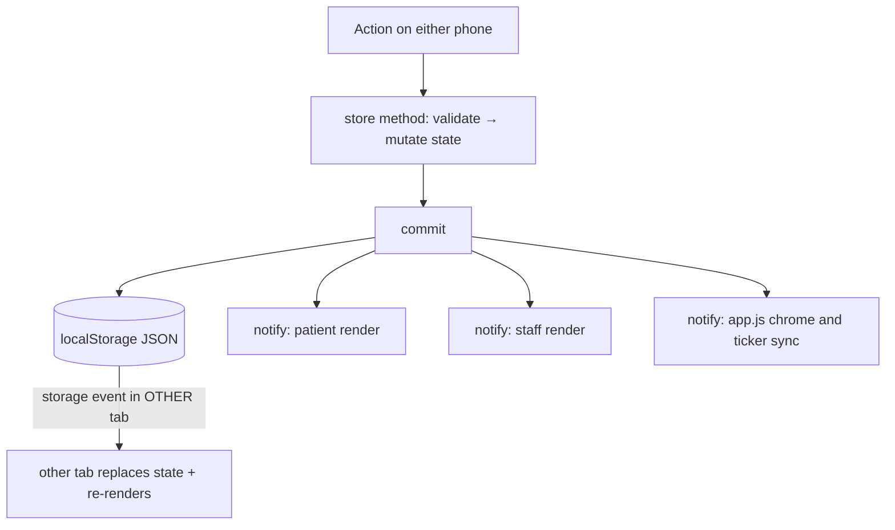

# MyTurn — System Documentation

Document date: 2026-10-27. Scope: the website and interactive demo in `site/` (landing page + Patient phone + Staff phone simulation).
This document was written by reading the actual source files (`site/index.html`, `site/js/*.js`, `site/css/styles.css`) and by executing scripted checks in a browser pane. It does not describe the design prototype in the project root except where noted.

## How to read the evidence labels

Every behavioural statement is tagged where it matters. Untagged text is a description of code structure.

| Label | Meaning |
|---|---|
| **VERIFIED-TEST** | Read in the code **and** exercised by a scripted browser check (see §15). |
| **VERIFIED-CODE** | Read in the code; not separately exercised by a test. |
| **UNVERIFIED** | Cannot be confirmed from the code or from available test evidence. |
| **NOT IMPLEMENTED** | Does not exist in this codebase (even if it exists in the design prototype or would be expected in production). |
| **ASSUMPTION / INTENT** | A design intention taken from copy or comments, not enforced by code. |

---

## Table of contents

1. [Product overview](#1-product-overview)
2. [Architecture and project structure](#2-architecture-and-project-structure)
3. [Patient journeys](#3-complete-patient-journeys)
4. [Staff journeys](#4-complete-staff-journeys)
5. [Every screen and UI interaction](#5-every-screen-and-ui-interaction)
6. [Queue lifecycle and business rules](#6-queue-lifecycle-and-business-rules)
7. [Shared Patient–Staff synchronization](#7-shared-patientstaff-synchronization)
8. [Data model and state management](#8-data-model-and-state-management)
9. [Authentication and permissions](#9-authentication-and-permissions)
10. [English / Hindi localization](#10-english--hindi-localization)
11. [Simulation controls](#11-simulation-controls)
12. [Animations and accessibility](#12-animations-and-accessibility)
13. [Error handling and edge cases](#13-error-handling-and-edge-cases)
14. [Running and demonstrating the project](#14-running-and-demonstrating-the-project)
15. [Testing and verification](#15-testing-and-verification)
16. [Limitations and future work](#16-limitations-and-future-work)
17. [End-to-end demonstration walkthrough](#17-complete-end-to-end-walkthrough)
- [Appendix A — Seed data](#appendix-a--seed-data) · [Appendix B — Message catalogue](#appendix-b--message-catalogue) · [Appendix C — Known defects found while documenting](#appendix-c--known-defects-found-while-documenting)

---

## 1. Product overview

### 1.1 What MyTurn does

MyTurn is a clinic-queue product concept. A **patient** registers for a clinic session from a phone, checks in on arrival, and follows a clear status ("Registered → Checked in → Waiting → Your turn"). **Clinic staff** run one shared queue per session: they see who has checked in, call the next patient, start and complete service, and handle missed turns and return requests under role-based rules.

The repository contains an **interactive hackathon demonstration** of that concept: a marketing-style landing page followed by two simulated Android phones (Patient and Staff) that read and write one shared state object.

### 1.2 The problem it addresses (as stated on the landing page)

From `site/index.html` and the `problem.*` / `how.*` strings in `site/js/i18n.js`:

- Patients cannot tell whether they are registered, checked in, or actually in the line.
- Paper/desk queues mean arrivals, calls and late returns are tracked by hand.
- After a missed turn nobody is sure what happens next or what the clinic promised.

The product's stated rules: **registration is not check-in**; staff call one patient at a time; the original place after a missed turn is **never promised**; no wait-time estimates are shown ("Not shown — only when reliable").

### 1.3 Intended users

| User | Where in the demo | Notes |
|---|---|---|
| Patient / family member | Patient phone (`#pf`) | One account (phone number) holds up to **7 saved patients** (self + family). |
| Queue operator (staff role `op`) | Staff phone (`#sf`) after signing in as `operator` | Runs the queue; limited to Riverside Hospital sessions; cannot override or reset. |
| Clinic administrator (staff role `admin`) | Staff phone after signing in as `admin` | All open sessions; can override a restricted return and reset a queue. |
| Presenter / judge | Landing page + scenario controls | Uses scenarios, Step queue, Reset demo, language toggle. |

### 1.4 System boundaries — simulated vs genuinely integrated

**Nothing in this project is integrated with an external system.** (**VERIFIED-CODE**: there is no `fetch`, `XMLHttpRequest`, `WebSocket`, or server code in `site/`.)

| Capability | Status |
|---|---|
| Hospital / clinic systems, EHR, appointment systems | **NOT IMPLEMENTED** — clinics, sessions, patients, rooms and hours are hard-coded sample data in `store.js` (`CLINICS`, `seed()`). |
| SMS / OTP delivery | **Simulated.** No SMS is sent. Any 6 digits verify, except `000000` (wrong) and `111111` (expired). |
| Patient authentication | **Simulated** (any 10-digit number signs in; unknown numbers are auto-created). |
| Staff authentication | **Simulated** with two hard-coded credentials (`operator`/`demo`, `admin`/`demo`). |
| Backend, database, real-time sync | **NOT IMPLEMENTED.** State lives in one JS object persisted to the browser's `localStorage`. "Real-time" sync is in-page function calls plus the `storage` event across tabs. |
| Queue "live data" | **Simulated.** The "other" patients are seeded rows advanced only by staff actions, the **Step queue** button, or the optional ticker. |
| Wait-time prediction | **NOT IMPLEMENTED by design.** The UI shows the number of people *ahead*, never minutes. |
| Notifications / push / SMS on "your turn" | **NOT IMPLEMENTED.** The patient screen updates in-app only. |
| Payments, medical records, triage | **NOT IMPLEMENTED / out of scope.** Copy states that queue order is not medical priority. |
| Account deletion | **Simulated** — the "Request deletion" dialog only shows a confirmation toast; no data is removed (`delData` in `patient.js`). |
| Account recovery (lost number) | **NOT IMPLEMENTED** (it exists only in the design prototype). |

---

## 2. Architecture and project structure

### 2.1 Project inventory

```
C:\Projects\MyTurn_Demo\
├─ MYTURN_SYSTEM_DOCUMENTATION.md        ← this file
├─ site\                                 ← the deliverable website (static, no build step)
│  ├─ index.html                         landing page + demo markup, script loading order
│  ├─ css\styles.css                     design tokens, layout, components, motion, reduced-motion
│  ├─ js\
│  │  ├─ i18n.js                         English/Hindi dictionary (MT.DICT)
│  │  ├─ store.js                        shared state + all queue/account/staff business rules (MT.store)
│  │  ├─ ui.js                           language helpers, icons, logo, chips, render+motion engine, event binding
│  │  ├─ patient.js                      Patient phone: screens, navigation, handlers
│  │  ├─ staff.js                        Staff phone: screens, handlers
│  │  ├─ app.js                          page chrome: scenario controls, walkthrough, scroll reveals, device scaling, ticker timer
│  │  └─ hero.js                         landing-hero illustration (self-contained looping mini-simulation)
│  └─ assets\fonts\                      Figtree + Noto Sans Devanagari WOFF2 (extracted from the supplied prototype bundle)
├─ .claude\launch.json                   preview-server config used during development (not needed to run the site; see §14)
├─ MyTurn Prototype (standalone).html    REFERENCE: approved design prototype (bundled React-based design canvas)
├─ MyTurn Master Brand Board (standalone).html / MyTurn-Master-Brand-Board-7680x4800.png   REFERENCE: brand system
└─ support.js                            REFERENCE: runtime used by the design prototype (NOT loaded by site/)
```

The four reference files were supplied by the user and were **not modified**. `site/` does not import or depend on them (fonts were copied out of the prototype bundle into `site/assets/fonts/`).

There is **no** `package.json`, bundler, linter, or committed test suite. **NOT IMPLEMENTED.**

Approximate sizes (bytes): `i18n.js` 78,684 · `styles.css` 53,672 · `patient.js` 32,016 · `staff.js` 16,924 · `store.js` 15,159 · `ui.js` 12,323 · `index.html` 8,517 · `app.js` 7,132 · `hero.js` 6,351. The dictionary holds **455** keys, every key has both an English and a Hindi string (checked with a Node script).

### 2.2 How the page loads

`site/index.html`:

1. `<head>`: an inline script adds class `js` to `<html>` (CSS uses `.js` to enable reveal animations only when JavaScript runs), then `css/styles.css` loads.
2. `<body>` contains static markup: skip link, sticky header (`#wm`, nav, `.nav-cta`, `#site-lang`), then sections `.hero`, `#problem`, `#how`, `#benefits`, `#demo` (the stage), and the footer.
3. Scripts load at the end of `<body>` in this fixed order (each attaches to the global namespace `window.MT`):

```
i18n.js → store.js → ui.js → patient.js → staff.js → app.js → hero.js
```

| Script | Sets up | Depends on |
|---|---|---|
| `i18n.js` | `MT.DICT` | — |
| `store.js` | `MT.store` (`S`); loads state from `localStorage` immediately; registers a `storage` listener | — |
| `ui.js` | `MT.t`, `MT.esc`, `MT.loc`, `MT.nm`, `MT.short`, `MT.icon`, `MT.logo`, `MT.chip`, `MT.langToggle`, `MT.renderInto`, `MT.bind`, `MT.cue`, `MT.setLang`, `MT.rerenders` | `MT.DICT`, `MT.store` (at call time) |
| `patient.js` | On `DOMContentLoaded`: binds events on `#pf`, registers `render` with `MT.rerenders` and `S.subscribe`, renders; exposes `MT.patient = { P, render }` | store, ui |
| `staff.js` | Same for `#sf`; exposes `MT.staff = { P, render }` | store, ui |
| `app.js` | Binds `#ctl` and `#site-lang`; `chrome()`, `fit()`, `initReveal()`, ticker timer | store, ui, patient, staff |
| `hero.js` | Builds `#hero-viz`; autoplay loop; exposes `MT.hero = { next, index, count }` | ui |

### 2.3 Component communication



Key design rules (**VERIFIED-CODE**):

- **Single source of truth:** `MT.store` holds one mutable object `state`. Both phones read it with `S.get()` and change it **only** through `S.*` methods.
- **Notify on write:** every mutating method ends in `commit()` → `save()` (JSON into `localStorage`) → call every function registered with `S.subscribe`. Both `patient.js` and `staff.js` subscribe their `render()`, so **both phones re-render after every state change, regardless of which one caused it**.
- **Render model:** each phone builds a complete HTML string for its current screen and calls `MT.renderInto(el, html, {key, dir})`, which replaces `innerHTML` and then applies motion only to elements that changed (§12).
- **Events:** `MT.bind(el, handlers)` attaches four delegated listeners (click, input, change, keydown) to each frame. Elements declare behaviour with `data-a="actionName"` (+ optional `data-v="value"`). Clicks on elements with `disabled` or `aria-disabled="true"` are ignored.
- **UI-only state** (current screen, form text, open dialogs, toasts) lives in a per-frame object `P` inside `patient.js` / `staff.js` and is **not** persisted (§8.4).

### 2.4 Rendering pipeline for one action

```mermaid
sequenceDiagram
  participant U as User click
  participant B as MT.bind (delegated listener)
  participant H as handler in patient.js / staff.js
  participant S as MT.store
  participant R1 as patient render()
  participant R2 as staff render()
  U->>B: click [data-a="callNext"]
  B->>B: skip if disabled / aria-disabled; set MT.actor = frame id
  B->>H: H.callNext(data-v, element, event)
  H->>S: S.callNext(sessionKey)
  S->>S: validate role + state, mutate entry, log(), commit()
  S->>S: save() to localStorage
  S-->>R1: subscriber: render()
  S-->>R2: subscriber: render()
  R1->>R1: MT.renderInto(): diff data-k/data-s, add mt-* classes
  R2->>R2: MT.renderInto(): diff data-k/data-s, add mt-* classes
  H->>H: act(result) → toast() → render() again (staff only)
```

---

## 3. Complete patient journeys

Patient code: `site/js/patient.js`. Screens are functions in the `SCREENS` map: `launch, phone, otp, home, patients, visits, pform, search, fac, whofor, review, success, visit, account`. Navigation is a history stack `P.hist` with helpers `go(screen)`, `back()`, `tab(screen)`.



### 3.1 First launch and language selection

- On load the patient phone shows `launch` (because `P.screen` starts as `'launch'` and, in `render()`, a **signed-in** account redirects `launch/phone/otp` → `home`; after a page reload with a persisted sign-in the phone therefore opens on **Home**). **VERIFIED-TEST** (state persistence across a fresh page load).
- The launch screen shows the wordmark, an **English | हिन्दी** selector, the tagline, a three-stop intro path, **Create account**, **I already have an account**, a **Clinic team → Staff sign in** row, and a demo hint (`98765 43210`).
- Language selection: `H.lang` → `MT.setLang('en'|'hi')` (see §10). One language applies to the whole page, both phones, and the hero illustration at once.
- "Staff sign in" row (`H.toStaff`): scrolls the page to the Staff phone column (`#staff-col`) and shows the toast "Staff app is on the right →". It does **not** navigate the Patient phone. **VERIFIED-CODE.**

### 3.2 Account creation and sign-in (phone + OTP simulation)

Both buttons call `H.start('signup'|'signin')`, which resets `P.phone`, `P.consent`, `P.phoneErr`, stores `P.mode`, and goes to `phone`. **Sign-up and sign-in behave identically** after that: `S.patientSignIn(phone)` creates an empty account if the number is unknown. **VERIFIED-CODE** (`patientSignIn` in `store.js`).

`phone` screen:

| Element | Behaviour |
|---|---|
| Mobile number input (`#phone`, `data-i="phone"`) | Non-digits are stripped on every keystroke (`H.input`), max length 10. Pressing **Enter** triggers `sendCode` (`data-enter`). |
| Consent checkbox | Stored in `P.consent`; must be ticked in both modes. |
| **Send code** (`H.sendCode`) | Requires `/^\d{10}$/` else error "Enter a 10-digit mobile number."; then requires consent else "Please agree to continue."; on success resets OTP counters and goes to `otp`. |

`otp` screen (`H.verify`, `H.resend`):

| Input | Result |
|---|---|
| Fewer than 6 digits | Error `err.otpLen`. |
| `111111` | Error `err.otpExpired` (simulated expired code). Does not count as a wrong try. |
| `000000` | `P.tries++`; error `err.otpWrong`; at **5** tries the error becomes `err.otpLocked`, the input and **Verify** are disabled. |
| Any other 6 digits | `S.patientSignIn(P.phone)`; history cleared; goes to `home`. |
| **Resend code** | Up to **3** resends (`P.resends`); each clears the field and error and shows toast "New code sent". At 3 the button reads "Resend limit reached" and is `aria-disabled`. |
| "Wrong number?" link | `back()` to the phone screen. |

The masked number shown is `+91 ••••• ••` + last 3 digits of the entered number. Country code is cosmetic. **VERIFIED-TEST** for wrong/expired/valid codes; the 5-try lock and 3-resend cap are **VERIFIED-CODE**.

**Account recovery: NOT IMPLEMENTED** (no screen or handler).

### 3.3 Saved patients (profiles)

Account data lives in `state.accounts[phone] = { nid, profiles: [{id, name, rel, yob}] }`. The seeded account **9876543210** has three profiles (Asha Verma/Myself, Ramesh Verma/Father, Meera Verma/Child). Any other number starts with zero profiles.

- **Patients tab** (`patients()`): title with "n of 7", a 7-segment progress bar, the list (avatar + name + relationship + age if a birth year exists; tap a row to select it as the default visit patient; **Edit** button), a duplicate-name warning chip, and a sticky **Add patient** button.
- **Limit of seven** (`MAX_PROFILES = 7`): enforced in `S.saveProfile` (`err('limit')`) and in the UI. At 7 the footer button reads "Add patient (limit reached)" and is `aria-disabled`; a banner explains nothing was replaced; the handlers `addProfile` / `addFromWho` additionally toast "You already have 7 saved patients…". **VERIFIED-TEST** (adding 7, the 8th rejected, delete frees a slot).
- **Profile form** (`pform`): Name (required, trimmed, max 40), Relationship (Myself, Father, Mother, Spouse, Child, Other), Year of birth (optional, 4 digits; must be 1900…current year else `err.yob`). **Save** → `S.saveProfile`. When editing, a **Remove patient** link opens a confirmation sheet → `S.deleteProfile`.
- Duplicate names are allowed; a "Same name as another patient" chip is shown.
- Deleting a profile **does not cancel** its active visit (the queue entry keeps the dangling `pid`; the ticket then omits the relationship text). **VERIFIED-TEST** (store-level) — see Appendix C.
- Selecting a profile: Home switcher strip or Patients list → `S.selectProfile(id)` (`state.patient.sel`); the avatar in the header shows the selected profile's initials.

### 3.4 Clinic discovery, session selection, registration

1. **Home** (`home()`): search bar (button → `search` screen), "Visit for" strip with up to 7 avatars + **Add**, "Active visit" tickets, "Clinics on MyTurn" (first 3 clinics + **See all**), sticky **Register for a visit**, bottom tabs.
2. **Search** (`search()`): live filter over `CLINICS` by English or Hindi name (`data-i="search"` re-renders on each keystroke); shows "n open now"; empty result → "No match found."
3. **Clinic** (`fac()`): sessions with status chips. Only sessions with `st === 'open'` are tappable. `later` ("Opens later today"), `closed` ("Not available"), `onsite` ("Register at reception") are greyed and `aria-disabled`. The hours are display text only — no clock logic. **VERIFIED-CODE.**
4. **Choose patient** (`whofor()`; `H.pickSess` pre-selects the selected profile if it has no active visit, otherwise the first free profile): radio rows; a profile that already has an **active visit anywhere** is dimmed with "Already registered for today's visit"; **Add another patient** (disabled at 7); **Continue** is disabled until a patient is chosen. If the account has no profiles, `pickSess` sends the user to the form first and returns to this step after saving.
5. **Review** (`review()`): Clinic, Session (with **Change**), Patient (with **Change**), "What happens next" box, sticky **Register for visit**. `H.changeSess` / `H.changeWho` rewrite the history stack to jump back.
6. **Submit** (`H.submit`): sets `P.submitting` (button disabled, label "Registering… please wait"), then after **700 ms** (simulated latency) calls `S.register(sessionKey, profileId)`. Extra taps while submitting are ignored (one entry only). **VERIFIED-TEST** (two clicks → one entry).
7. **Success** (`success()`): confirmation, ticket with the token (e.g. **K 044**), numbered next steps, **Back to home** link, sticky **View my visit**.

`S.register` preconditions and results: network on (`state.net`) else `offline`; session exists and is `open` else `closed`; profile belongs to the account else `noProfile`; profile has no active visit in **any** session else `dup`. On success a new entry `{st:'reg'}` is appended to the session queue and the next token is issued (§6.2). The patient is **not** in the waiting line yet (registration ≠ check-in).

### 3.5 Check-in and the active visit

`visit()` renders by entry status (`e.st`). Common parts: back header, ticket (token, chip, session, clinic · hours, "For {name} ({relationship})"), a status line (`sline`), the path/lane, extra details, footer action.

| Status | Status line | Path | Footer / actions |
|---|---|---|---|
| `reg` | "Registered · not checked in…" (info) | amber on step 1 | **Check in** (primary); "Cancel visit" link; note "Only when you are at the clinic. Needs internet; the clinic confirms." |
| `wait`, people ahead > 0 | "You are in the queue" + "Checked in — confirmed by the clinic" | Registered ✓ Checked in ✓ **Waiting (amber)** Your turn | rows "Ahead of you: N", "Waiting time: Not shown — only when reliable", "K nnn is in service now." (if any), "What to do now", "Cancel visit" |
| `wait`, ahead = 0 | amber "Your turn is next. Please stay close to the waiting area." | same | same |
| `called` | amber "Your turn — Please go to Room {room} now." | first three ✓, **Your turn (amber)** | "Cancel visit" link (unless a cancel request is already pending → notice "Cancellation requested — waiting for reception to confirm.") |
| `svc` | green "You are in service now." | all four ✓ | none |
| `done` | green "Your visit is completed. Thank you." | all four ✓ | **Done** (→ Home) |
| `missed` | amber "Missed turn" + explanation | dashed **return lane**, amber on "Missed turn" | **Request to return** (primary), **Not now** (back), "Cancel visit" link |
| `retreq` | info "Return requested — waiting for the clinic to review." + "We cannot show a place or time." | lane, amber on "Requested" | "Cancel visit" link |
| `retq` | green "Return accepted. Staff will call you after the current treatment, when you are eligible." + "We cannot show a place or time." | lane, amber on "Return queue" | "Cancel visit" link |
| `declined` | grey "The clinic could not accept your return…" | none | none |
| `noshow` | grey "The clinic recorded that you did not arrive…" | none | none |
| `cancelled` | grey "You cancelled…" / "The clinic cancelled…" (by `note`) | none | none |

**Position shown:** "ahead" = the number of entries **before** this one in the array whose status is `wait` (`visit()`); `reg` entries are not counted, and a patient in the return queue shows no position. The UI never shows minutes.

**Check-in** (`H.checkIn` → `S.checkIn`): allowed only when the status is `reg` and the network is on; the entry becomes `wait` and is **moved to the end of the queue array** (ordering by check-in time). Offline → toast "No internet — reception not told". **VERIFIED-TEST.**

### 3.6 Visit history

`visits()` ("Visits" tab): "Active visit" tickets, then "Earlier visits": this phone number's terminal entries (`done`, `declined`, `cancelled`, `noshow`) plus **two hard-coded sample rows** ("General Medicine · Riverside Hospital — 12 Oct · K 031", "Eye Clinic · Maple Street Eye Clinic — 2 Sep · M 017"). The sample rows are static text. **VERIFIED-CODE.** The footer retention note says retention rules are an open production decision.

### 3.7 Cancellation

`H.cancelVisit` opens a confirmation sheet (different body text if the patient was already called), then `S.patientCancel`:

| Entry status | Result |
|---|---|
| `reg`, `wait`, `retreq`, `retq` | Becomes `cancelled`, `note:'patient'`; toast "Visit cancelled". |
| `called` | **Not** cancelled: `cancelReq = true`; toast "Request sent — reception will confirm". Staff see "Patient asked to cancel" and a **Cancel visit** link. Starting service clears the flag. |
| `missed`, `svc`, `done`, terminal states | Store returns `err('state')` → toast "That is no longer possible…". |
| network off | `offline` → toast "No internet — nothing was cancelled". |

**Defect:** the Missed-turn screen shows a "Cancel visit" link but the store rejects it (Appendix C #1). **VERIFIED-TEST** at store level.

### 3.8 Missed turns and return requests (patient side)

See §6.4. In short: staff mark a called patient as missed → patient sees the **Missed turn** screen → **Request to return** (`H.reqReturn` → `S.requestReturn`, needs `missed` + network) → status `retreq` → staff accept/decline → `retq` ("Return accepted") or `declined`. **VERIFIED-TEST.**

### 3.9 Account screen, deletion request, logout

`account()` shows the masked number, the **English | हिन्दी** selector, **Sign out** (`H.signout` → `S.patientSignOut()` clears `state.patient`, `P.screen = 'launch'`; **saved patients and queue entries remain** in state), and **Request deletion of your data** → sheet → toast "Deletion request sent". No data is deleted. **VERIFIED-CODE.**

---

## 4. Complete staff journeys

Staff code: `site/js/staff.js`; business rules in `store.js`. Screens: `login()`, `sessions()`, `queue()`.



### 4.1 Sign-in, credentials, roles

- Fields: Staff ID (`#s_user`), Password (`#s_pw`, masked). **Enter** in either field submits. **Use operator login / Use admin login** buttons only **fill** the fields (`H.quick`), they do not sign in.
- `S.staffLogin(user, pw)`: user is trimmed and lower-cased; password is **case-sensitive**.

| Staff ID | Password | Role | Sessions visible |
|---|---|---|---|
| `operator` | `demo` | `op` (Queue operator) | **Riverside Hospital** open sessions only: `rv:gm` General Medicine, `rv:ch` Children's Clinic |
| `admin` | `demo` | `admin` (Clinic administrator) | **All open sessions**: `rv:gm, rv:ch, lv:gp, ng:pd, me:ey` |

- Wrong credentials → error "Couldn't sign in. Check the staff ID and password." and the password field is cleared. **VERIFIED-TEST.**
- The login screen states clearly that it is demo-only.
- The signed-in staff session (`state.staff = {user, role, sess}`) is **persisted** in `localStorage`; after a page reload the Staff phone returns to the sessions list or the open queue. **VERIFIED-TEST** (second tab loaded with the persisted state).

### 4.2 Session selection

`sessions()` lists `S.staffSessions()` with clinic · room · hours, the role line, and "N waiting". Opening a session calls `S.openSession(key)`; a key outside the role's list returns `forbidden` (toast "Not permitted for your role."). Queues are seeded only for `rv:gm` and `rv:ch`; other sessions (admin-only) start empty. **VERIFIED-TEST.**

### 4.3 The queue desk

Header (dark): back arrow (to sessions), "MyTurn Staff", "{role} · sample data", language selector, sign-out icon button.

Body, top to bottom (`queue()`):

1. Session title + "Open" chip; clinic · room · hours.
2. A slim notice **only while someone is called or in service**: "Finish K nnn before calling the next."
3. **Stats**: Waiting, In service (1 if someone is called/in service), Late (missed + return requested), Return (return queue).
4. **Tabs**: Queue, Return (count = late + return), Finished.
5. The tab content (a keyed block `list:<tab>`).
6. **Session tools** expandable: privacy note, **Reset queue**, **Choose another session**, "Recent actions" (last 6 audit entries).
7. Sticky footer: **Call next** (primary).

Names are shown as **first name + last initial** (`MT.short`), e.g. "Asha V." (**VERIFIED-CODE**).

#### Queue tab

| Block | Rows and actions |
|---|---|
| "In service now" | If a patient is **called**: row with chip "Called", buttons **Start service**, **Mark missed** (and a **Cancel visit** link if the patient asked to cancel). If a patient is **in service**: **Complete service**. Otherwise "No patient is in service right now." |
| "Waiting" | The first **3** `wait` entries (array order) with **Call** (disabled while someone is called/in service) and a **Mark no-show** link; a "Show N more / Show less" toggle (`P.waitAll`). |
| "Not checked in · K…" | A collapsed one-line summary listing tokens of `reg` entries; expanding (`P.regOpen`) shows rows with **Mark arrived** and **Mark no-show**. |

#### Return tab

| Block | Rows and actions |
|---|---|
| "Late arrivals · review required" (`missed`) | **Mark late arrival** (→ `retreq`, note `staff`) and **Cancel visit** link. |
| "Return requested · review" (`retreq`) | **Accept return** + **Decline return** when policy allows. When the policy is `admin` (scenario *Late return*): the operator sees a disabled "Accept return" and the message "Not permitted — administrator override only. Ask a clinic administrator."; the admin sees **Override and accept (administrator)** with a confirmation. |
| "Return queue" (`retq`) | **Call** (disabled while busy) and **Cancel visit**; note "Return accepted under clinic policy / by administrator override. Not ahead of others automatically." |
| Empty | "Return queue is empty — Late arrivals you accept after review will wait here." |

#### Finished tab

Terminal entries (`done`, `noshow`, `declined`, `cancelled`), newest first, read-only.

#### Call next (footer)

- Enabled only when nobody is called/in service **and** at least one `wait` or `retq` entry exists.
- Disabled labels: "Mark current patient done first" or "No one waiting to call".
- `S.callNext(key)` picks the **first `wait` entry in array order; if none, the first `retq`**. It marks it `called` and logs `call`.

### 4.4 Role permissions (enforced in the store, not only in the UI)

| Action | Unauthenticated | Operator | Administrator |
|---|---|---|---|
| Call, Start, Complete, Mark missed, Mark arrived, No-show, Accept (policy `allow`), Decline, Cancel visit | `auth` error | ✔ | ✔ |
| Accept return when policy = `admin` (without override) | — | `adminOnly` error | `adminOnly` error — admin must use **Override** |
| Override and accept (`acceptReturn(id, true)`) | — | `forbidden` | ✔ |
| Reset queue (`resetQueue`) | `forbidden` | `forbidden` | ✔ |
| Open a session outside own list (`openSession`) | — | `forbidden` for non-Riverside | ✔ for all open sessions |

**VERIFIED-TEST** (direct store calls: `acceptReturn(...,false)` → `adminOnly`, `acceptReturn(...,true)` as operator → `forbidden`, `resetQueue` as operator → `forbidden`, unauthenticated `callNext` → `auth`).
The Reset button for the operator is visible but dashed ("locked"); clicking opens an informational sheet "Administrator only" without a confirm action. **VERIFIED-TEST.**

### 4.5 Queue reset and logout

- **Reset queue** (admin): confirmation sheet → `S.resetQueue(key)` sets `state.q[key] = []`, logs `reset`. The token counter `ctr[key]` is **not** reset, so the next registration continues the numbering. **VERIFIED-TEST** (queue empty afterwards); counter behaviour **VERIFIED-CODE.**
- **Logout**: sign-out icon in the header or "Session tools" → `S.staffLogout()` clears `state.staff`; the Staff phone returns to `login`.

---

## 5. Every screen and UI interaction

### 5.1 Landing page (`index.html`, `app.js`, `hero.js`)

| Element | Behaviour |
|---|---|
| Skip link "Skip to demo" | Anchor `#demo`; visible on focus. |
| Header nav (The problem / How it works / Benefits) | Anchor links; smooth scroll with `scroll-padding-top: 61px` so targets land flush under the sticky header. Hidden below 900 px. **VERIFIED-TEST** (each lands at 61 px from top). |
| Header **Live demo** button | Anchor `#demo`. |
| Header language selector `#site-lang` | `H.lang` → `MT.setLang`; rebuilt only when the language changes. |
| Hero CTAs | **Explore the live demo** → `#demo`; **How it works** → `#how`. |
| Hero illustration (`#hero-viz`) | Self-contained loop (see §11.6). Button `#hv-btn`: "Pause animation" / "Play animation" (`aria-pressed`), or "Show next state" under reduced motion. |
| Problem / How it works / Benefits | Static content; revealed on scroll (§12). "Benefits" ends with another **Explore the live demo** button. |
| Demo section | Heading, scenario toolbar `#ctl`, step message `#step-msg`, two phones, walkthrough `#script` (`<details class="walk">`). |
| Footer | Brand, "About this prototype" (consolidated disclaimer, `disc.p`), "Brand and language" (`foot.notes`). |

### 5.2 Demo controls (`app.js`)

See §11. Controls: scenario pills (Normal flow / Missed turn / Late return), **Reset demo**, **Step queue ▸**, **Auto-advance ticker** switch, **Patient offline** switch, walkthrough `<details>`.

### 5.3 Patient phone — chrome shared by all screens (`frame()` in `patient.js`)

Status bar (`MT.sb`): static "9:41", camera hole, signal/Wi-Fi/battery icons (decorative, `aria-hidden`). Home indicator bar (`MT.hb`). When `state.net` is false, every authenticated screen shows a warning banner "No internet — actions are paused. Saved info may be out of date." Toast (`role="status"`) auto-clears after 2.8 s. Confirmation sheet (`role="dialog" aria-modal="true"`): tapping the dimmed backdrop or **Go back/Close** closes it; the primary button runs the stored callback.

### 5.4 Patient screens — controls reference

| Screen | Control (handler) | Precondition | Result |
|---|---|---|---|
| **launch** | English / हिन्दी (`lang`) | — | Switches language everywhere. |
| | Create account / I already have an account (`start`) | — | → `phone` (mode stored, no behavioural difference). |
| | Staff sign in (`toStaff`) | — | Scrolls page to Staff phone; toast. |
| **phone** | Back (`back`) | — | → previous screen. |
| | Number field (`input`/Enter) | — | Digits only, 10 max. |
| | Consent checkbox | — | `P.consent`. |
| | Send code (`sendCode`) | 10 digits + consent | → `otp`; else inline error. |
| **otp** | Code field (`input`/Enter) | — | Digits only, 6 max; disabled after 5 wrong codes. |
| | Verify (`verify`) | not locked | See §3.2. |
| | Resend code (`resend`) | < 3 resends | Clears, toast; at 3 `aria-disabled`. |
| | Wrong number? (`back`) | — | → `phone`. |
| **home** | Avatar button (`tab` account) | — | → Account tab. |
| | Search bar / See all / **Register for a visit** (`newVisit`) | — | Clears search, → `search`. |
| | Manage (`tab` patients) | — | → Patients tab. |
| | Profile strip (`selProfile`) / Add (`addProfile`) | Add hidden at 7 | Selects profile / opens form. |
| | Ticket (`openVisit`) | active visit exists | → `visit`. |
| | Clinic row (`pickFac`) | — | → `fac`. |
| | Bottom tabs (`tab`) | — | Home / Patients / Visits / Account (history cleared). |
| **patients** | Row (`selProfile`), Edit (`editProfile`), Add (`addProfile`) | Add disabled at 7 | See §3.3. |
| **pform** | Name, Relationship (`change`), Year of birth, Save (`saveProfile`), Remove (`delProfile`) | Name required | Errors `err.name`, `err.yob`, `err.limit`. |
| **visits** | Ticket (`openVisit`), Register (`newVisit`) | — | — |
| **search** | Search field (`input`) | — | Live filter; clinic row → `pickFac`. |
| **fac** | Open session row (`pickSess`) | session `open` | → `whofor` (or `pform` if no patients). Non-open rows are inert. |
| **whofor** | Radio row (`pickWho`), Add another (`addFromWho`), Continue (`whoNext`) | profile has no active visit; Continue needs a selection | → `review`. |
| **review** | Change session / patient (`changeSess`/`changeWho`), **Register for visit** (`submit`) | not already submitting | 0.7 s later → `success`, or an inline error. |
| **success** | View my visit (`openVisit`), Back to home (`tab` home) | — | — |
| **visit** | Check in (`checkIn`), Cancel visit (`cancelVisit`), Request to return (`reqReturn`), Not now (`back`), Done (`tab` home) | per status table in §3.5 | — |
| **account** | Language selector, Sign out (`signout`), Request deletion (`delData`) | — | See §3.9. |

### 5.5 Staff screens — controls reference

| Screen | Control (handler) | Precondition | Result |
|---|---|---|---|
| **login** | Language selector | — | — |
| | Use operator / admin login (`quick`) | — | Fills fields only. |
| | Sign in (`login`) / Enter | valid credentials | → sessions. |
| **sessions** | Session row (`openSession`) | in role's list | → queue (tab reset to Queue). |
| | Language, Sign out icon (`logout`) | — | — |
| **queue** | Back arrow (`closeSession`) | — | → sessions. |
| | Tabs (`tab`) | — | Switch block; keyed block animates in. |
| | Call (`call`) | row status `wait`/`retq`; nobody called/in service | Row → `called`. Disabled otherwise. |
| | Start service (`start`) | status `called` | → `svc`. |
| | Complete service (`complete`) | status `svc` | → `done`. |
| | Mark missed (`missed`) | status `called` | → `missed`. |
| | Mark arrived (`arrived`) | status `reg` → `wait`; status `missed` → `retreq` | — |
| | Mark no-show (`noshow`) | status `reg` or `wait` | Confirmation sheet → `noshow`. |
| | Accept return (`accept`) | `retreq`, policy `allow` | → `retq`. |
| | Override and accept (`override`) | `retreq`, role admin | Confirmation → `retq` (`note:'override'`). |
| | Decline return (`decline`) | `retreq` | Confirmation → `declined`. |
| | Cancel visit (`cancel`) | any active status in a shown row | Confirmation → `cancelled` (`note:'staff'`). |
| | Call next (`callNext`) | not busy; a `wait`/`retq` exists | See §4.3. |
| | Show more / Not checked in / Session tools (`toggleWait`/`toggleReg`/`toggleMore`) | — | Expand/collapse (UI-only state). |
| | Reset queue (`reset`) | admin (operator gets an info sheet) | Confirmation → clears queue. |
| | Choose another session (`closeSession`) | — | → sessions. |

All staff handlers display a toast through `act(result, okMessage)`: errors map through `errKey` (Appendix B).

### 5.6 Status chips

Defined once in `ui.js` (`CHIP` + `MT.chip`) and reused everywhere. Glyph + word + colour (never colour alone).

| Entry status | Chip class / glyph | English (patient) | English (staff) | Hindi (patient) |
|---|---|---|---|---|
| `reg` | info `i` | Registered | Registered | पंजीकृत |
| `wait` | info `i` | Waiting | Waiting | प्रतीक्षा में |
| `called` | attn `!` | Your turn | **Called** (`st.calledStaff`) | आपकी बारी |
| `svc` | live `▶` | In service | In service | सेवा में |
| `done` | ok `✓` | Completed | Completed | पूर्ण |
| `missed` | warn `!` | Missed turn | Missed turn | बारी निकली |
| `retreq` | attn `!` | Return requested | Return requested | वापसी का अनुरोध |
| `retq` | info `i` | Return accepted | Return accepted | वापसी स्वीकृत |
| `declined` | neutral `—` | Can't rejoin | Can't rejoin | वापस नहीं आ सकते |
| `cancelled` | neutral `—` | Cancelled | Cancelled | रद्द |
| `noshow` | neutral `—` | No-show | No-show | नहीं आया |

(The staff list overrides the label for `called` via `chipKey: 'st.calledStaff'` in `staff.js`.)

---

## 6. Queue lifecycle and business rules

### 6.1 Queue entry (`state.q[sessionKey][]`)

```js
{ id: 'rv:gm#44',      // session key + '#' + counter
  tok: 'K 044',        // session token letter + space + 3-digit counter
  name: 'Asha Verma',  // copied from the profile (seed rows: 'First L.')
  st: 'wait',          // status — see below
  acct: '9876543210',  // phone of the owning patient account, or null for seeded "other" patients
  pid: 'p1',           // profile id (patients only), or null
  cancelReq: false,    // patient asked to cancel while 'called'
  note: null,          // 'app'|'staff' (who created a return request), 'ok'|'override' (accepted), 'patient'|'staff' (cancelled by)
  by: null }           // role that accepted a return ('op'|'admin')
```

### 6.2 Token generation and ordering

- One counter per session: `state.ctr['rv:gm']`. `S.register` issues `n = ctr[key]++`, token = session letter (`K` General Medicine, `C` Children's, `G` General Practice, `P` Paediatrics OPD, `M` Maple Eye; `E`/`D`/`S`/`V` exist for non-open sessions) + space + `n` padded to 3 digits.
- Entry id = `<sessionKey>#<n>`. Counters are never decremented; `resetQueue` leaves them. A scenario reset (`seed()`) re-initialises them.
- **Order = array order** within the session. New registrations append. **Check-in** (patient `checkIn` or staff `markArrived` from `reg`) **moves the entry to the end** (`moveToEnd`), so waiting order follows check-in time, not registration time.
- Terminal entries stay in the array (shown in Finished / history).

### 6.3 Status model and valid transitions

Statuses: `reg` (registered, not in line), `wait` (checked in), `called`, `svc` (in service), `done`, `missed`, `retreq` (return requested), `retq` (return accepted, in return queue), `declined`, `cancelled`, `noshow`.
`ACTIVE = [reg, wait, called, svc, missed, retreq, retq]`; the other four are terminal.



Transition table (all in `store.js`):

| From → To | Method | Actor | Guards |
|---|---|---|---|
| (new) → `reg` | `register(key, pid)` | patient | network on; session `open`; profile in account; no active visit for that profile in any session |
| `reg` → `wait` | `checkIn(id)` | patient | network on; status `reg` |
| `reg` → `wait` | `markArrived(id)` | staff | any role; moves to end |
| `reg`/`wait` → `noshow` | `markNoShow(id)` | staff | — |
| `wait`/`retq` → `called` | `call(id)` | staff | no entry `called` or `svc` in that session |
| first `wait` (else first `retq`) → `called` | `callNext(key)` | staff | same guard; `empty` error if neither exists |
| `called` → `svc` | `start(id)` | staff | also clears `cancelReq` |
| `svc` → `done` | `complete(id)` | staff | — |
| `called` → `missed` | `markMissed(id)` | staff | — |
| `missed` → `retreq` | `requestReturn(id)` | patient | network on; `note='app'` |
| `missed` → `retreq` | `markArrived(id)` | staff | `note='staff'` |
| `retreq` → `retq` | `acceptReturn(id, override)` | staff | see §6.5 |
| `retreq` → `declined` | `declineReturn(id)` | staff | — |
| `reg`/`wait`/`retreq`/`retq` → `cancelled` | `patientCancel(id)` | patient | network on |
| `called`: set `cancelReq` | `patientCancel(id)` | patient | network on; status unchanged |
| any ACTIVE → `cancelled` | `cancelVisit(id)` | staff | (UI offers it on called-with-request, missed, and return-queue rows) |

Any other combination returns `err('state')`. **VERIFIED-TEST** for the main path, cancel paths, double check-in (`state`), call while busy, and offline blocks.

### 6.4 One patient in service at a time

`busy(list)` is true if any entry in the session is `called` **or** `svc`. `call`/`callNext` return `busy` while true; the UI disables **Call** and replaces the footer with "Mark current patient done first". **VERIFIED-TEST.**

### 6.5 Missed turns and the return queue

- There is **no timer or grace period**: a turn is "missed" only when staff press **Mark missed** on a called patient (or the seed data starts an entry as `missed`). **VERIFIED-CODE.** (The "clinic policy window" is described in copy only.)
- A missed patient may **Request to return** (→ `retreq`) or staff may **Mark late arrival** (→ `retreq`, `note:'staff'`).
- **Policy** `state.policy.returns`: `'allow'` (default, scenarios *Normal* and *Missed*) or `'admin'` (scenario *Late return*). There is **no UI to change it** other than choosing the scenario.
  - `allow`: operator or admin can **Accept return** → `retq`.
  - `admin`: `acceptReturn(id,false)` fails with `adminOnly` for everyone; only an administrator using **Override** (`acceptReturn(id,true)`) succeeds (`note:'override'`, logged `override`).
- An accepted patient is in the **return queue** (`retq`). They are called by **Call** on their row (when nobody is busy) or by **Call next** only when **no `wait` entry remains**. They are **never automatically ahead** of waiting patients. The patient sees no position or time.
- **Decline** → `declined` (terminal); the patient may register again (terminal entries do not block `activeVisitFor`).

### 6.6 Exceptions, assumptions, and unimplemented rules

| Topic | Status |
|---|---|
| Registration only for sessions with `st:'open'` | **VERIFIED-TEST** |
| "Same-day only" registration | **ASSUMPTION / INTENT** — copy says same-day; no date logic exists. |
| Session opening hours / "later today" becoming open | **NOT IMPLEMENTED** — static labels. |
| Missed-turn time window | **NOT IMPLEMENTED** (manual). |
| Max return attempts, return ordering policy | **NOT IMPLEMENTED.** |
| Auto no-show / auto cancel | **NOT IMPLEMENTED.** |
| Priority / triage | **NOT IMPLEMENTED** by design. |
| Staff cancelling a patient in service | Allowed by `cancelVisit` (store) but no UI control. **VERIFIED-CODE.** |
| Patient cancelling when `missed` | UI offers it, store rejects (Appendix C). |
| Concurrent staff on the same session | Not modelled; last write wins in `localStorage`. |

---

## 7. Shared Patient–Staff synchronization

### 7.1 Architecture

Both phones are views of **one object** (`MT.store.get()`), not two copies. There is no message passing between phones; each phone merely re-renders when the store notifies it. **VERIFIED-CODE.**



Cross-tab: `store.js` listens for the browser `storage` event; when another tab writes `myturn.demo.v1`, the listener replaces `state` and notifies subscribers (without re-saving). **VERIFIED-TEST** (a second tab called `callNext`/`complete`; the first tab's staff frame showed "Called" within 0.6 s).

### 7.2 Event flows

**Registration** (patient → staff)

1. Patient taps **Register for visit** → `P.submitting = true` → render (button disabled).
2. 700 ms later: `S.register()` appends `{st:'reg', tok:'K 044', acct, pid}`; `commit()`.
3. Patient `render()` → `success` screen. Staff `render()` → the new patient is counted under "Not checked in · K 042, K 044" (collapsed row; expand to see the row). Staff **Waiting** count is unchanged.

**Check-in** (patient → staff)

1. Patient taps **Check in** → `S.checkIn(id)`: `reg → wait`, moved to end.
2. Patient: chip "Waiting", path Waiting amber, "N ahead of you". Staff: a new **Waiting** row appears (keyed `row:<id>`) with an enter animation and highlight; the Waiting stat ticks; the staff phone gets a brief amber ring (`mt-sync`). **VERIFIED-TEST.**

**Calling** (staff → patient)

1. Staff taps **Call next** (or **Call** on the row) → `S.callNext/call`: `wait → called`.
2. Staff: the row moves into "In service now" with chip "Called", **Start service / Mark missed** buttons, highlight; footer becomes "Mark current patient done first".
3. Patient: status line swaps to "Your turn — Please go to Room 4 now.", chip becomes "Your turn", the path moves to the amber fourth step; the patient phone gets the ring cue. **VERIFIED-TEST.**

**Service start / completion**

`Start service` → `svc` (patient: "You are in service now.", all steps ✓). `Complete service` → `done` (patient: "Your visit is completed", **Done**; staff: row moves to Finished; footer re-enables **Call next** if others wait). **VERIFIED-TEST.**

**Missed turn → return request → recovery**

1. Staff **Mark missed** → `missed`. Patient: "Missed turn" explanation, dashed return lane.
2. Patient **Request to return** → `retreq`. Staff: Return tab shows the row under "Return requested · review" (Return tab count updates).
3. Staff **Accept return** (policy `allow`) → `retq`. Patient: "Return accepted… We cannot show a place or time." Staff: row under "Return queue".
4. Staff **Call** → `called`; **Start service**; **Complete service**. **VERIFIED-TEST** (whole chain).

### 7.3 Ordering guarantees

All updates are synchronous within one JS task: the store mutates, saves, and calls both renderers before returning. Animations are applied *after* the DOM already shows the new state and never block input (§12). Staff handlers call `toast()` after the action, which triggers a **second** render of the staff phone; `MT.renderInto` carries running animations across that second render so highlights are not cut short (`anims` carry-over in `ui.js`). **VERIFIED-TEST.**

---

## 8. Data model and state management

### 8.1 State shape (`seed()` in `store.js`)

```js
{
  v: 1,                          // schema version; a stored object with another v is discarded
  scenario: 'normal',            // 'normal' | 'missed' | 'late'
  net: true,                     // false = "patient offline" simulation
  ticker: false,                 // auto-advance ticker enabled
  accounts: {
    '9876543210': { nid: 4, profiles: [
      { id:'p1', name:'Asha Verma',   rel:'Myself', yob:1991 },
      { id:'p2', name:'Ramesh Verma', rel:'Father', yob:1958 },
      { id:'p3', name:'Meera Verma',  rel:'Child',  yob:2019 } ] }
  },
  patient: { phone: null, sel: null },          // current patient session
  staff:   { user: null, role: null, sess: null },   // role: 'op' | 'admin'; sess: session key or null
  policy:  { returns: 'allow' },                // 'admin' in scenario 'late'
  q:   { 'rv:gm': [ …entries ], 'rv:ch': [ … ], 'rv:ey': [], 'rv:dn': [], 'lv:gp': [], 'lv:sk': [], 'ng:pd': [], 'ng:vc': [], 'me:ey': [] },
  ctr: { 'rv:gm': 44, 'rv:ch': 104, … },        // next token number per session
  audit: [ { who:'operator', action:'call', tok:'K 044', t: 1790000000000 } ]   // newest first, max 30
}
```

- **Static data (not in state):** `CLINICS` (4 clinics, 9 sessions; fields `id, en, hi, sessions[{id, tok, room, en, hi, hours[en,hi], st}]`), `HI_NAMES` (Hindi renderings of seed names), `DEMO_USERS`, `ACTIVE`, `MAX_PROFILES`.
- **Accounts:** keyed by the typed phone number; created empty on first sign-in. Profile ids are `p<nid>` with a per-account counter.
- **Seven-profile limit:** `S.saveProfile` rejects creation at `profiles.length >= 7`; editing an existing profile is unaffected.
- **Staff sessions:** `state.staff` is the single staff login (one staff user at a time per browser).
- **Audit log:** `log(who, action, entry)` is called by staff actions only: `call, start, done, missed, arrived, noshow, accept, override, decline, cancel, reset`. Patient actions, logins and logouts are **not** logged. The Staff phone shows the latest 6 under Session tools. `who` is `'operator'` or `'admin'`.

### 8.2 Persistence

| Item | Where | Notes |
|---|---|---|
| Whole state object | `localStorage['myturn.demo.v1']` (JSON) | Written on every `commit()`. Read at script load (`load()`); on any parse error or version mismatch falls back to `seed('normal')`. All `localStorage` calls are wrapped in `try/catch`; if storage is blocked the demo works in memory only. |
| Language | `localStorage['myturn.lang']` (`'en'`/`'hi'`) | Read in `ui.js`; **not** part of `state`, so scenario resets do not change it. |
| Everything else | Memory only | See §8.4. |

Verified keys present after use: only `myturn.demo.v1` (+ `myturn.lang` once a language is chosen). State keys: `v, scenario, net, ticker, accounts, patient, staff, policy, q, ctr, audit`. **VERIFIED-TEST.**

### 8.3 Reset behaviour

`S.reset(scenario)` replaces the **entire** state with a fresh `seed(scenario)` (so: any accounts created at runtime and their profiles are **lost**; both phones are signed out; `net` = true; `ticker` = false; policy per scenario; queues, counters and audit log restored), then `commit()`. Language is unaffected. The Patient phone's UI-only screen is not reset by the store; `patient.js` `render()` sends a signed-out user on an authenticated screen back to `launch`, but a phone sitting on `phone`/`otp` screens stays there. **VERIFIED-TEST** (for sign-out and queue restoration); the stale `otp` screen observation came from a test run. See Appendix C.

### 8.4 Data that exists only in memory

- `patient.js` `P`: `screen, hist, mode, phone, consent, phoneErr, otp, otpErr, tries, resends, form, formErr, formFrom, search, fac, sess, who, visit, sheet, toast, submitting, regErr` and the closure variables `sheetFn`, `toastTimer`, `lastKey`, `lastDepth`.
- `staff.js` `P`: `user, pw, authErr, tab, sheet, toast, more, waitAll, regOpen` and `sheetFn`, `toastTimer`, `lastRank`. Note `more/waitAll/regOpen/tab` persist across sessions/logins within a page view.
- `app.js`: ticker `timer`, `walkOpen`, `ctlLang`, `scriptKey`, `lastScen`.
- `hero.js`: `idx`, `paused`, `visible`, `timer`, `prev`.
- `ui.js`: `MT.actor`, per-container `el.__mt` (last render key and running animations).
- A **page reload** therefore keeps accounts/queues/logins/language but loses the current screen, typed text, open dialogs, and tab selection. **VERIFIED-TEST** (reload showed persisted state).

---

## 9. Authentication and permissions

> **The authentication in this project is a demonstration only. It is not production authentication and provides no security.**

### 9.1 Patient

- Any 10-digit number is accepted; no number format (e.g. Indian mobile prefix) is checked.
- Consent checkbox is required but nothing is recorded.
- OTP rules: see §3.2. The "5 wrong tries" lock and "3 resends" cap exist only in `P` memory; **tapping Back and Send code resets both counters** (`sendCode` sets `P.tries = 0; P.resends = 0`) — the lock is bypassable. **VERIFIED-CODE.**
- Sign-up and sign-in are the same operation; an unknown number silently becomes a new account.
- The signed-in phone number is persisted in `state.patient.phone` (localStorage) — no token, no expiry.

### 9.2 Staff

- Credentials are literal strings in client-side code (`DEMO_USERS`). Anyone who can open DevTools can read them. The password is compared in plain text.
- The UI states "DEMO-ONLY sign-in … Not real security." and "Demo-only sign-in. A real deployment would need organisation sign-in and server-side role checks."
- Role checks are implemented in the **client-side store** (`acceptReturn`, `resetQueue`, `openSession`, `_staff()`), so they protect the demo's logic from UI mistakes but **not** from a user who edits `localStorage` or calls `MT.store` from the console. **VERIFIED-CODE.**

### 9.3 Logout

- Patient: clears `state.patient` only. Staff: clears `state.staff` only. Neither clears the other, accounts, queues or language. In-memory screen state is reset by the next `render()` guards.

### 9.4 Security limitations (summary)

No server, no encryption, no real OTP, plaintext credentials, bypassable lockout, state editable by the user, no audit of logins, no CSRF/XSS review beyond output escaping (`MT.esc` is applied to interpolated values in templates — **VERIFIED-CODE**, but **no security review or penetration test was performed**).

---

## 10. English / Hindi localization

### 10.1 Mechanism (`i18n.js`, `ui.js`)

- `MT.DICT` is an object `{ key: [english, hindi] }` (455 keys; none has an empty Hindi string; placeholder tokens such as `{n}` match in both languages — checked with a script).
- `MT.t(key, params)` → picks index 0 or 1 by `MT.lang`, then replaces `{name}` placeholders. **Fallback:** a key that does not exist returns **the key itself** (visible as raw text); there is no English fallback for missing Hindi because every key has both.
- Several dictionary blocks are appended with `Object.assign(D, {…})` later in the file; **later assignments override earlier ones** for the same key (e.g. copy-audit overrides).
- Static page text uses `data-t="key"` attributes; `app.js` `chrome()` sets `textContent` from the dictionary on every state change and language change.
- Seed names have Hindi renderings in `HI_NAMES` (`MT.nm(name)`); **names typed by users are shown as typed.** Clinic/session names carry `hi` fields in `CLINICS` (`MT.loc`). Hours strings carry a Hindi variant.

### 10.2 Selection and persistence

- Selectors (`MT.langToggle`) appear in the page header, on the Patient launch/phone/otp/account screens, and in the Staff header and login. All read **English | हिन्दी**. Clicking calls `MT.setLang`, which stores `myturn.lang`, sets `<html lang>`, re-renders everything registered in `MT.rerenders` (both phones, page chrome, hero), and plays a short cross-fade class `mt-lang` (skipped under reduced motion).
- Initial language: stored value if `'en'` or `'hi'`, else English. **VERIFIED-TEST** (language persisted after reload).

### 10.3 Coverage and caveats

- **VERIFIED-TEST:** with Hindi selected, a text scan of the page, footer and both phones found no raw dictionary keys; overflow audits of all patient screens, nine visit states, and all three staff tabs found no horizontal overflow in Hindi.
- **Draft copy:** the footer and design notes state Hindi copy is a **draft awaiting native-speaker review**. No linguistic review was done.
- Not localized: the status-bar time "9:41", demo credentials, phone digits, history sample dates ("12 Oct"), token text, the `MyTurn` wordmark. Mixed-script strings (e.g. English tokens inside Hindi sentences) are intentional.
- Not covered: pluralization rules, locale-specific number/date formats, right-to-left layouts (not needed for Hindi).

---

## 11. Simulation controls

All controls are built in `app.js` (`controls()`, `syncControls()`, handler map `H`) and bound to `#ctl`.

### 11.1 Scenarios

Buttons call `S.reset(scenarioId)`, which re-seeds **everything** (§8.3). Seed rows for session `rv:gm` (tokens start at K 038; the next registration is always **K 044** in all three scenarios — **VERIFIED-TEST**):

| Scenario | rv:gm seed (token : name : status) | Policy |
|---|---|---|
| **Normal flow** | 038 Meena R. done · 039 Ravi S. **svc** · 040 Asha V. wait · 041 Imran K. wait · 042 Ramesh V. reg · 043 Sita D. missed | `allow` |
| **Missed turn** | 038 Meena R. done · 039 Ravi S. done · 040 Asha V. done · 041 Imran K. done · 042 Ramesh V. **svc** · 043 Sita D. wait | `allow` |
| **Late return** | 038 done · 039 Ravi S. svc · 040 Asha V. wait · 041 Imran K. **retreq** (note `app`) · 042 Ramesh V. reg · 043 Sita D. missed | **`admin`** |

`rv:ch` is seeded identically in all scenarios (101 Lata P. done · 102 Dev S. svc · 103 Neha T. wait; next token C 104).
The demo script shown beside the phones changes with the scenario (`ACT` actor tags + `script.<scenario>.<n>` strings).

### 11.2 Reset demo

`S.reset(S.get().scenario)`: same scenario, fresh seed.

### 11.3 Step queue ▸

`S.tick()` is a **one-step advance of the non-patient entries in every session**:

```text
for each session:
   if an entry is 'svc'    and it is NOT a patient's (acct == null) → done
   else if an entry is 'called' and NOT a patient's              → svc
   else if nothing is called/svc: take the first 'wait' entry; if it is NOT a patient's → called
(patient-owned entries are never advanced; 'reg', 'missed', 'retreq', 'retq' are never advanced)
```
It returns `true` if anything changed. If nothing changed the page shows "Nothing to advance — the next person in line is the patient's, so staff must act." for 2.5 s. In the Normal scenario with K 044 checked in, seven presses bring K 044 to "Your turn is next"; the eighth shows the message. **VERIFIED-TEST** (store-level: the queue stops with K 044 `wait`).

### 11.4 Auto-advance ticker

Switch `data-i="ticker"` → `S.setTicker(bool)`. `sync()` in `app.js` starts `setInterval(() => S.tick(), 4000)` when enabled and clears it when disabled. **Off by default** and after every reset. Because it uses `tick()`, it stops at the patient and never moves patient-owned entries. Timer behaviour in a hidden/throttled tab is browser-dependent (**UNVERIFIED** beyond a brief on/off test: when on, the queue advanced; when off, it did not).

### 11.5 Patient offline

Switch `data-i="offline"` → `S.setNet(!checked)`. While `state.net === false`: `register`, `checkIn`, `patientCancel`, `requestReturn` return `offline`; the Patient phone shows a banner and toasts "No internet — …". **Staff actions are unaffected.** **VERIFIED-TEST** (register/check-in/cancel blocked).

### 11.6 Hero illustration loop (`hero.js`)

Not connected to `MT.store`. Eight scripted states for ticket K 044 beside K 043 (ahead) and K 045 (behind): Registered → Waiting → Your turn / Called → Missed turn → Return requested → Return accepted → In service → Completed (then loops). Autoplays every 2.6 s only when visible and the document is not hidden and reduced motion is **not** requested; the button pauses/resumes (or steps manually under reduced motion). `MT.hero.next()` steps it programmatically. **VERIFIED-TEST** (all eight states, path/lane, chips, cues stepped via `MT.hero.next`); **timed autoplay itself was not observed** in the test browser because the pane reported `document.hidden` (**UNVERIFIED** for real-time playback).

---

## 12. Animations and accessibility

### 12.1 Motion system (`styles.css` end sections, `ui.js`)

Tokens: `--ease: cubic-bezier(.2,.7,.2,1)`; durations 120 ms (press), 220 ms (state), 600 ms (reveal). No libraries.

| Layer | Implementation | Triggers |
|---|---|---|
| Button/row press feedback | CSS `:active` scale .97/.94; hover lifts on CTAs; underline draw on nav links | pointer/keyboard activation |
| Screen transitions | `MT.renderInto(..., {key, dir})`: when the screen key changes, class `mt-screen` with `--dx` (±14 px) on `.ph-body/.launch/.ph-foot` | navigation in either phone |
| Element changes | Elements with `data-k` (identity) and `data-s` (signature). New key → `mt-in` (+ `mt-flash` when `data-f`); changed signature → `data-m` class (`mt-flash`/`mt-pop`/`mt-swap`/`mt-tick`); changed rows glide via Web Animations `translateY` (FLIP) when `data-flip` | any store change |
| Cross-device cue | `MT.cue(phone,'mt-sync')` amber ring on the phone that did **not** cause the change (`MT.actor` set in `MT.bind`) | any change that animated |
| Carry-over | Running animations are re-applied with a negative `animation-delay` after follow-up renders (toasts) | staff actions |
| Sheets/toasts | Keyed `sheet` / `toast` elements animate on first appearance only | dialogs |
| Controls | Pills/switches updated **in place** (`syncControls`), so CSS transitions run; walkthrough steps stagger on scenario change | scenario/ticker/offline |
| Language | `body.mt-lang` cross-fade 260 ms | language change |
| Landing | Hero entrance (CSS keyframes, staged delays, only until `.live` is added after 1.8 s); scroll reveals via `IntersectionObserver` adding `.in` once (`initReveal`) | load / scroll |

Principles enforced in code: animation classes are added **after** the DOM already reflects the new state; nothing awaits `animationend`; unrelated renders do not animate (a staff-only UI toggle left the patient frame's markup byte-identical — **VERIFIED-TEST**).

### 12.2 Reduced motion

- CSS: `@media (prefers-reduced-motion: reduce)` sets near-zero animation/transition durations, removes delays, forces `.reveal` visible, and disables smooth scrolling.
- JS: `MT.reduced()` is checked before every cue; with it true, `renderInto` returns before adding motion classes, `initReveal` reveals everything immediately, the hero does not autoplay and its button becomes "Show next state".
- **VERIFIED-TEST by simulation only:** the test replaced `window.matchMedia` to return `matches: true`; no `mt-*` classes were added and the hero button changed. The operating-system setting itself was **not** toggled (**UNVERIFIED** on real systems).

### 12.3 Keyboard, touch, focus

- All interactive elements are native `<button>`, `<a>`, `<input>`, `<select>`, `<label>` or `<details>`. Visible focus: `:focus-visible { outline: 3px solid amber }`.
- Enter submits phone/OTP/staff-login fields (`data-enter`). A skip link exists.
- Touch targets are ≥ 40–44 px for primary controls (CSS `min-height`); pointer-only hover effects are decorative.
- `MT.renderInto` restores focus after re-render for inputs (by `id`, with caret) and for buttons carrying `data-a`/`data-v`. **VERIFIED-TEST** for a staff toggle button.
- ARIA used: `aria-pressed` on toggles and language buttons, `aria-current="page"` on tab bar, `aria-expanded` on expanders, `aria-label` on icon buttons, `aria-live="polite"` for the Step-queue message, `role="status"` on toasts, `role="dialog" aria-modal="true"` on sheets, `aria-hidden` on decorative icons/status bar/hero art.
- Scrollbars are hidden globally (CSS) while scrolling by wheel/touch/keyboard still works. **VERIFIED-TEST** (no scrollbar gutters measured).

### 12.4 Known accessibility gaps

- **Dialogs:** no focus is moved into a sheet, focus is not trapped, **Escape does not close it** (no key handler). **VERIFIED-CODE.**
- Queue/status changes on the phones are **not announced** to screen readers (only toasts and the step message are live regions).
- The status bar, camera hole and home bar are decorative; the phone "devices" are not landmarks.
- Contrast: chips and amber notes follow the brand palette; **no automated contrast audit was run** (**UNVERIFIED**). Some small text (11–12 px mono labels) is small.
- No testing with NVDA/JAWS/VoiceOver/TalkBack, no zoom-to-200% test, no forced-colors test (**UNVERIFIED**).
- Hero autoplay can be paused (satisfies pause-for-motion) but pauses only via its button, page-hidden, or off-screen.

---

## 13. Error handling and edge cases

| Case | Behaviour | Evidence |
|---|---|---|
| Double-tap **Register for visit** | Second tap ignored while `P.submitting`; exactly one entry created. | VERIFIED-TEST |
| Register same profile twice (any session) | `dup`; Choose-patient list also dims profiles with an active visit. | VERIFIED-TEST (store) |
| Register while offline | `offline`; inline error on Review ("No internet — nothing was sent…"). | VERIFIED-TEST (store) |
| Register for a non-open session | `closed`; UI doesn't allow tapping non-open sessions. | VERIFIED-CODE |
| Invalid phone / no consent | Inline errors, no navigation. | VERIFIED-TEST (consent) / CODE (length) |
| Wrong OTP, expired OTP | `000000` wrong, `111111` expired. | VERIFIED-TEST |
| 5 wrong OTPs / 3 resends | Locked / disabled (bypassable via Back + Send code). | VERIFIED-CODE |
| Check-in offline | Blocked; toast "No internet — reception not told". | VERIFIED-TEST |
| Check-in twice / on wrong status | `state` error → toast "That is no longer possible…". | VERIFIED-TEST (store) |
| Patient cancel offline | Blocked; toast. | VERIFIED-TEST (store) |
| Patient cancel when called | Becomes a **request** (`cancelReq`) staff must confirm. | VERIFIED-TEST (store) |
| Patient cancel when missed | Store rejects → error toast (defect). | VERIFIED-TEST (store) |
| Call while someone is called/in service | Button disabled; store returns `busy`/`state`. | VERIFIED-TEST |
| Call next with nobody waiting | Footer shows "No one waiting to call" (disabled); store `empty`. | VERIFIED-CODE |
| Operator accept under restricted policy | Button replaced by disabled one + explanation; store `adminOnly`. | VERIFIED-TEST |
| Operator override / reset | Store `forbidden`; reset button shows info sheet. | VERIFIED-TEST |
| Unauthenticated staff store call | `auth` (or `forbidden` for reset). | VERIFIED-TEST |
| Wrong staff credentials | Inline error; password cleared. | VERIFIED-TEST |
| Profile limit | 8th rejected, banner + toast; deleting frees a slot. | VERIFIED-TEST |
| Invalid birth year / empty name | Inline errors. | VERIFIED-CODE |
| Delete profile with active visit | Visit kept (dangling `pid`). | VERIFIED-TEST (store) |
| Visit disappears (e.g. staff reset queue) while patient on the visit screen | `render()` redirects to Home (`!S.byId`). | VERIFIED-CODE |
| Empty states | Home "No visit registered yet."; search "No match found."; staff "Return queue is empty", "Nothing finished yet.", "Registrations and check-ins will appear here." | VERIFIED-CODE |
| Storage blocked / corrupt | Falls back to in-memory seed; no crash (try/catch). | VERIFIED-CODE; blocked storage **UNVERIFIED** |
| Network "failure/retry" | Only the manual **Patient offline** switch exists; there is no automatic retry or random failure injection. | VERIFIED-CODE |
| Re-render during typing | Inputs keep value, caret and focus (`renderInto` restores by element `id`). | VERIFIED-CODE (focus restoration of a *button* was tested; caret restoration inside text inputs was not separately tested) |

Error code → message mapping: Appendix B.

---

## 14. Running and demonstrating the project

### 14.1 Prerequisites

- A modern Chromium-based browser (the only one used in testing).
- A way to serve `site/` over **HTTP**. No Node build, no dependencies, no internet required at runtime (fonts are bundled).

### 14.2 Start commands

The site is plain static files. Serve the `site` directory on any port:

```bash
# Option 1 (UNVERIFIED here; needs Node + npm access the first time)
npx serve site -l 5173

# Option 2 (UNVERIFIED here; needs Python 3)
python -m http.server 5173 --directory site
```

**VERIFIED in this project:** a minimal Node static server (Node v24.21.0, Windows 11). Save as `serve.js` anywhere and run `node serve.js <absolute-path-to-site> 5173`:

```js
const http=require('http'),fs=require('fs'),path=require('path');
const root=path.resolve(process.argv[2]),port=+process.argv[3]||5173;
const mime={'.html':'text/html; charset=utf-8','.js':'text/javascript','.css':'text/css','.woff2':'font/woff2','.svg':'image/svg+xml','.png':'image/png'};
http.createServer((q,r)=>{let p=decodeURIComponent(q.url.split('?')[0]);if(p.endsWith('/'))p+='index.html';const f=path.join(root,p);
 if(!f.startsWith(root)){r.writeHead(403);return r.end();}
 fs.readFile(f,(e,d)=>{if(e){r.writeHead(404);return r.end('404');}r.writeHead(200,{'Content-Type':mime[path.extname(f)]||'application/octet-stream','Cache-Control':'no-store'});r.end(d);});
}).listen(port,()=>console.log('listening',port));
```

Local URL: `http://localhost:5173/`.

Notes:
- **Opening `site/index.html` directly from disk (`file://`) is UNVERIFIED** in a normal browser. The development preview pane showed `file://` pages as non-executing snapshots, so use HTTP.
- `.claude/launch.json` is a developer preview config with an **absolute path to a script outside the project** (the author's scratch folder); it is not required and is not portable.
- Recommended display: desktop ≥ 1280 px wide. The phones are fixed 393 × 873 CSS px screens scaled to fit (`fit()` in `app.js`, floor 0.78 side-by-side).

### 14.3 Demo credentials

| Who | Credentials |
|---|---|
| Patient (with 3 saved patients) | Number `9876543210`, any 6-digit code except `000000`/`111111` (use `123456`) |
| Patient (empty account) | Any other 10-digit number (e.g. `9123456780`) |
| Staff operator | `operator` / `demo` |
| Staff administrator | `admin` / `demo` |

### 14.4 Restoring the initial scenario

- Click **Reset demo** (re-seeds the current scenario; both phones signed out; language kept), or click the **Normal flow** pill.
- Full wipe: in DevTools console run `localStorage.clear(); location.reload();` (also clears the saved language).

### 14.5 Recommended presentation order

1. Landing page top to bottom (hero → problem → how it works → benefits) — 60–90 s.
2. **Explore the live demo** → run §17 on *Normal flow*.
3. Switch to Hindi mid-flow to show both phones updating.
4. *Late return* scenario → show the operator being blocked and the admin override.
5. **Reset demo** to leave the page clean.

---

## 15. Testing and verification

### 15.1 What exists

There is **no automated test suite in the repository.** All checks were ad-hoc JavaScript snippets run in the browser pane (via the pane's script-execution tool) against the running static server, plus screenshots and Node syntax checks (`node --check` on every JS file) and a Node script that validated the dictionary (every key has both languages; placeholders match).

### 15.2 Scripted checks that were run and passed (last runs)

| Area | What was checked | Result |
|---|---|---|
| Patient journey | Launch → sign in (wrong code, expired code, valid) → Home → register (double-tap → one entry, token K 044) → success → visit | Pass |
| Staff journey | Wrong then valid login; session list (operator: 2 sessions; admin: 5); queue shows K 044; check-in updates staff; Step queue; Call next; Mark missed; return request; Accept; Call; Start; Complete | Pass |
| Synchronization | After each action the other frame's text/state changed in the same task; cross-tab sync with a second tab | Pass |
| Roles | Operator blocked from accept under policy `admin`, override, reset (UI + store); admin override and reset; unauthenticated actions rejected; logout | Pass |
| Profiles | Add 7, 8th rejected (UI + store), delete frees slot, duplicate-name chip | Pass |
| Offline | Register/check-in/cancel blocked | Pass |
| Language | EN↔HI from the page header; persisted after reload; no raw keys; no horizontal overflow across all patient screens, 9 visit states, 3 staff tabs | Pass |
| Reset/scenarios | Reset demo, scenario switch signs out both phones and restores seed; all scenarios give token K 044 | Pass |
| Layout | Phones are exactly 393×873; key screens (launch, home, active visit, staff sign-in, session list, queue incl. called, return, finished) have **zero** inner scroll overflow in EN and HI | Pass (the only legitimately scrolling case found: Staff **Return** tab in the *Late return* scenario, ~34–47 px) |
| Responsive page | Viewports 1920×1080, 1440×900, 1366×768, 1280×800, 1024×768, 768×1024, 600×900, 393×851 (reported 394), 360×740: no horizontal overflow; two phones side-by-side ≥ ~1000 px and stacked below | Pass |
| Navigation | Hero CTAs, nav links, header CTA, benefits CTA land at 61 px under the header and reveal content | Pass |
| Motion | Classes added for check-in row, call (patient line, chip, ring), start/complete, missed lane, return tab, sheet, language fade, scenario pills in place; none for unrelated changes; reduced-motion gating (simulated) | Pass |
| Hero illustration | Eight states stepped; geometry (dots on one baseline, even spacing, equal rows, aligned names, equal chip heights); width 480→280 px in EN/HI | Pass (240 px slightly clips lane labels — below any real container) |
| Store rules | Dup/offline/double check-in/cancel variants/busy/called-cancel flag/ticker stop/role lists/credential variants | Pass |

During development some checks **failed and were fixed** (e.g. the operator Reset button was unclickable so no explanation appeared; a header CSS clash hid the demo button; a class name collision restyled the phone intro path). Failures caused only by wrong test expectations are not listed as product defects.

### 15.3 Not tested / unverified

- **Real devices** (Android/iOS phones, tablets, touch gestures) and **real network conditions**.
- **Browsers other than the Chromium-based pane** (Firefox, Safari, Edge, mobile browsers); features used include `IntersectionObserver`, `Element.animate`, CSS `svh`, `:focus-visible`, `scroll-padding`.
- Screen readers, keyboard-only end-to-end run, 200% zoom, forced-colors, print.
- The **operating-system reduced-motion setting** (only simulated).
- **Timed autoplay** of the hero loop and long-running ticker behaviour (pane reported the page as hidden at times).
- `file://` opening; blocked/disabled `localStorage`; very old browsers.
- Performance (frame rate, long sessions), memory growth.
- Concurrency (two staff users), multi-tab write conflicts beyond one successful propagation test.

---

## 16. Limitations and future work

### 16.1 Missing or simulated

- Real backend, database, and real-time transport (WebSocket/SSE); multi-device sync; server-authoritative atomic transitions and idempotent requests.
- Real patient auth (SMS/OTP provider, rate-limiting, abuse protection, session tokens) and real staff auth (SSO/staff IDs, server-enforced roles).
- Real clinic/session data, clinic-configurable policies (registration windows, check-in rules, missed-turn window, cancellation and return rules), time/date logic, holidays.
- Notifications (SMS/push) — explicitly absent.
- Account recovery, real data deletion/retention, consent records, audit storage and review process.
- Admin configuration UI (policy is only switchable by scenario).
- Staff UI for cancelling an in-service patient; patient reschedule; multi-room/multi-desk.
- Analytics, error monitoring, logging.

### 16.2 Mock data

All clinics, patients, tokens, rooms, hours, history rows, seed names and queue entries; Hindi names for seed patients; "9:41" status bar.

### 16.3 Technical debt (observed in code)

- Whole-screen `innerHTML` rendering with a hand-written diff for motion; large template strings in `patient.js`/`staff.js`; global `window.MT` namespace; no module system, types, or tests.
- `S.reset` has a leftover unused local (`keepNet`).
- `patient.js` contains a no-op `dirReset` helper.
- CSS is a single 564-line file with later blocks overriding earlier ones (several features are defined twice, e.g. section rhythm and hero illustration overrides).
- Dictionary uses cumulative `Object.assign` overrides; older entries remain as dead strings.
- Reset does not reset in-memory UI state (see Appendix C #3).
- State schema versioning is minimal (`v: 1`; mismatched versions are discarded silently).

### 16.4 Unverified assumptions

- That the layout and motion perform well on low-end Android and non-Chromium browsers.
- That the Hindi translations are idiomatic (draft).
- That contrast ratios of all brand colour combinations meet WCAG AA at the used sizes.
- That the brand-board tokens (marked "proposed, pending final approval") are final.

### 16.5 Work required for a production deployment

Server-side queue service with authoritative state and event streaming; authentication/authorization, secrets and SSO; privacy and retention policy, consent, encryption, deletion pipeline; clinic configuration and admin tools; accessibility audit and native-language review; notification channels; load/failure/offline testing; observability; security review and penetration test; compliance review. None of these are claimed or provided by the demo.

---

## 17. Complete end-to-end walkthrough

Start from **Normal flow** (press **Reset demo** first). Both phones begin signed out.

**Part A — Patient registers**

1. Scroll to the demo (**Explore the live demo**). Confirm the scenario pill **Normal flow** is on and the ticker switch is off.
2. *Patient phone:* tap **I already have an account** → type `9876543210` → tick the consent box → **Send code**.
3. Type `123456` → **Verify**. Home opens with **Asha** selected, "No visit registered yet." and three clinics.
4. Tap **Register for a visit** → tap **Riverside Hospital** → tap **General Medicine** (Open for registration).
5. "Who is this visit for?" shows **Asha Verma** pre-selected → **Continue** → review "Riverside Hospital / General Medicine / Asha Verma" → **Register for visit**. After ~0.7 s the success screen shows token **K 044**. Tap **View my visit**: status "Registered · not checked in".

**Part B — Staff sees the registration**

6. *Staff phone:* tap **Use operator login** → **Sign in** → tap **General Medicine**.
7. The queue shows "In service now: K 039 Ravi S.", Waiting K 040, K 041, and a collapsed row "Not checked in · K 042, K 044". Expand it to show K 044 (not checked in). Note the footer says "Mark current patient done first".

**Part C — Check-in and synchronized updates**

8. *Patient phone:* tap **Check in**. Watch both phones: the patient chip becomes **Waiting** and the path moves to Waiting with "2 ahead of you"; on the staff phone a **K 044** row slides into Waiting (third row), highlighted, and the Waiting stat rises to 3.
9. Press **Step queue ▸** once: K 039 completes (staff row moves to Finished). Press again: K 040 is **Called**; again: **In service**; again: **Completed**. Continue pressing (K 041 follows the same four steps; seven presses in total) until the patient shows "Your turn is next. Please stay close to the waiting area." An eighth press shows "Nothing to advance — … staff must act." (This is the point where only staff can proceed.)

**Part D — Staff calls the patient**

10. *Staff phone:* tap **Call next**. K 044 moves into "In service now" with chip **Called**; the patient phone switches to **Your turn — Please go to Room 4 now.** with the amber fourth step, and its device frame briefly rings amber.

**Part E — Missed turn and recovery**

11. *Staff phone:* tap **Mark missed**. The patient sees **Missed turn** with the dashed return lane (no place or time promised).
12. *Patient phone:* tap **Request to return**. The staff **Return** tab count rises; open the **Return** tab: K 044 appears under "Return requested · review".
13. *Staff phone:* tap **Accept return** (policy allows it in this scenario). The patient sees **Return accepted — We cannot show a place or time.**; the staff row moves under "Return queue".
14. *Staff phone:* tap **Call** on K 044 → patient sees **Your turn** again. Switch to the **Queue** tab → **Start service** (patient: "You are in service now.") → **Complete service**.
15. The patient sees **Completed** and **Done**; the staff row is in **Finished**. Check the patient's **Visits** tab for the completed visit.

**Optional extensions**

16. Language: click **हिन्दी** in the page header (both phones and the page change, including chips and the walkthrough); switch back to **English**.
17. Restricted return: select **Late return** → sign in as `operator` → **General Medicine** → **Return** tab: "Accept return" is blocked with an administrator-only message → **Sign out** → sign in as `admin` → **Return** tab → **Override and accept (administrator)** → confirm.
18. Permission denial: as operator open **Session tools** → **Reset queue** → informational "Administrator only" sheet. As admin the same button opens a confirmation and, once confirmed, empties the queue.
19. Profile limit: sign in with a new number (e.g. `9123456780`), open **Patients**, add seven patients → the button reads "Add patient (limit reached)".
20. Restore: **Reset demo** (or click **Normal flow**).

---

## Appendix A — Seed data

**Clinics and sessions (`CLINICS` in `store.js`)**

| Clinic id | Name | Session id | Token | Room | Status | Hours (EN) |
|---|---|---|---|---|---|---|
| `rv` | Riverside Hospital | `gm` General Medicine | K | 4 | open | 8:00 AM – 12:00 PM |
| | | `ch` Children's Clinic | C | 2 | open | 8:30 AM – 11:30 AM |
| | | `ey` Eye Clinic | E | 6 | later | 1:30 PM – 4:00 PM |
| | | `dn` Dental Clinic | D | 7 | closed | Next session Tuesday |
| `lv` | Lakeview Family Clinic | `gp` General Practice | G | 1 | open | 9:00 AM – 1:00 PM |
| | | `sk` Skin Clinic | S | 3 | later | 2:00 PM – 5:00 PM |
| `ng` | Northgate Children's Hospital | `pd` Paediatrics OPD | P | 5 | open | 8:00 AM – 12:00 PM |
| | | `vc` Vaccination | V | 8 | onsite | 9:00 AM – 12:00 PM |
| `me` | Maple Street Eye Clinic | `ey` Eye Clinic | M | 2 | open | 10:00 AM – 2:00 PM |

Session keys used in state: `rv:gm, rv:ch, rv:ey, rv:dn, lv:gp, lv:sk, ng:pd, ng:vc, me:ey`. Open sessions: `rv:gm, rv:ch, lv:gp, ng:pd, me:ey`.

**Seed account:** phone `9876543210` with profiles p1 Asha Verma (Myself, 1991), p2 Ramesh Verma (Father, 1958), p3 Meera Verma (Child, 2019); `nid: 4`.

**Queue seeds:** see §11.1 (rv:gm per scenario; rv:ch constant).

## Appendix B — Message catalogue

Patient (`errKey` in `patient.js`, strings in `i18n.js`):

| Store/UI code | Key | English text |
|---|---|---|
| `offline` (register) | `err.offline` | No internet — nothing was sent. Try again when you are back online. |
| `offline` (check-in) | `err.checkOffline` | No internet — reception not told |
| `offline` (cancel) | `err.cancelOffline` | No internet — nothing was cancelled |
| `closed` | `err.closed` | This session is not open for app registration. |
| `dup` | `err.dup` | This patient is already registered for today's visit. |
| `limit` | `err.limit` | You already have 7 saved patients. Remove one first — nothing was replaced. |
| `name` | `err.name` | Enter a name. |
| `yob` | `err.yob` | Enter a valid 4-digit year, or leave it blank. |
| `state`, `noProfile`, `auth`, `gone` | `err.state` | That is no longer possible — the visit has changed. Please check its latest status. |
| phone invalid / no consent | `err.phone` / `err.consent` | Enter a 10-digit mobile number. / Please agree to continue. |
| OTP | `err.otpLen`, `err.otpWrong`, `err.otpExpired`, `err.otpLocked` | Enter all 6 digits. / That code isn't right. Try again. / This code has expired. Ask for a new one. / Too many wrong codes. For your safety, wait before trying again, or ask the clinic help desk. |

Staff (`errKey` in `staff.js`): `forbidden` → "Not permitted for your role."; `adminOnly` → "Not permitted — administrator override only."; `busy` → "Mark the current patient done first."; `empty` → "No one waiting to call."; `state`/`auth` → "That is no longer possible — the visit has changed."; login failure → "Couldn't sign in. Check the staff ID and password."

Staff success toasts: `toast.called` "{tok} called", `toast.calledGeneric`, `toast.completed`, `toast.missed`, `toast.arrived`, `toast.noshow`, `toast.accepted`, `toast.overridden`, `toast.declined`, `toast.cancelledV`, `toast.reset`.

## Appendix C — Known defects found while documenting

These were confirmed by reading the code and/or by a scripted check; **no source files were changed** to fix them, per the documentation-only instruction.

1. **Patient "Cancel visit" on the Missed-turn screen fails.** The screen offers the link, but `S.patientCancel` rejects status `missed` (`err('state')`), so the patient sees the generic "That is no longer possible" toast. Staff can still cancel from the Return tab. (VERIFIED-TEST at store level; the toast is inferred from the `cancelVisit` handler.)
2. **OTP lockout/resend cap is bypassable** by going Back and pressing **Send code** (counters reset). Irrelevant to a demo but must not be described as security.
3. **Reset does not reset in-memory screen state.** After **Reset demo** the Patient phone can remain on the `phone`/`otp` screen (only authenticated screens redirect to `launch`), and Staff UI flags (`more`, `waitAll`, `regOpen`, selected tab) persist. A fresh page load clears them.
4. **Deleting a profile keeps its active visit** with a dangling `pid`; the ticket just omits the relationship.
5. **Hidden-page timers:** the optional ticker and the hero autoplay depend on browser timers; they pause when the page is hidden (hero) or may be throttled.
6. **`.claude/launch.json` points outside the project** (absolute path) and is only a development aid.
7. **Hindi text is draft** and un-reviewed; seed names have Hindi forms but user-entered names do not.

---

## 18. Addendum — shared server and Telegram bot (added after sections 1–17 were written)

> Sections 1–17 describe the **browser-only** demo. They remain accurate when the site is served by a plain static server. This addendum documents the optional shared server and Telegram bot. Where §1.4/§2/§8 say "no backend", read "no backend **unless `server/server.js` is used**".

### 18.1 What was added

| File | Purpose |
|---|---|
| `server/server.js` | Zero-dependency Node server. Runs the website's own `site/js/store.js` inside an isolated `vm` (queue rules are not duplicated), keeps the **authoritative** queue state, serves `site/` and a small API (`GET /api/state`, `GET /api/events` (SSE), `POST /api/action`). Binds to `127.0.0.1` by default. |
| `server/bot.js` | Telegram bot (long polling, built-in `fetch`, no dependencies). Commands `/start /register /token /status /help` with inline buttons. |
| `server/test/e2e-fake-telegram.js` | End-to-end test against a **local fake** of the Telegram Bot API (no real bot involved). |
| `site/js/store.js` (edited) | New block at the end: if `/api/state` answers, the browser loads server state before rendering, still runs actions locally, **forwards each action to the server as a command**, and replaces its queue data with every state the server pushes. Without a server it does nothing (static hosting and `file://` behave exactly as before). |
| `.env.example`, `.gitignore` | Placeholders only; `.env` is git-ignored. |

### 18.2 How shared state works

- The browser **never sends state, only commands** (`method` + `args` + its own session). A stale tab therefore cannot overwrite newer server state. **VERIFIED-TEST:** a deliberately stale `localStorage` copy lost to the server on reload.
- Each server commit increments `rev`; browsers ignore pushes with an older `rev`. Each demo reset increments `epoch`; a browser seeing a new epoch drops its local patient/staff sessions, so **Reset demo is consistent** (from the UI or from any other client). **VERIFIED-TEST.**
- Per-browser data stays local: who is signed in, the offline switch, the ticker.
- Server API checks: method allow-list, argument and session validation, body size limit; staff-only rules still run in the store (e.g. operator `resetQueue` → `forbidden`). **Limitation:** the server trusts the role the browser claims, because there is no real staff authentication (demo only).
- Patient phone ids of the form `tg:*` are **reserved**; the HTTP API rejects them, so a browser cannot act as a Telegram user. **VERIFIED-TEST.**

### 18.3 Telegram identity and flow

- A Telegram user is the account `tg:<telegram user id>` (private chats only). The bot looks up only entries with that `acct`, so one user cannot read another's token or status. **VERIFIED-TEST** (fake Telegram, two users). The website patient accounts cannot see Telegram entries either.
- **Registration is remote only:** `/register` → clinic → service (only sessions with `st:'open'` from the shared data) → confirm → `store.register()`. The entry starts as `reg` (**not checked in**). Check-in is done on the website by staff (**Not checked in → Mark arrived**), the existing on-site workflow. There is no Telegram check-in.
- Repeated confirm taps and re-delivered updates do not create duplicates (the store allows one active visit per profile; `update_id` is de-duplicated).
- `/token` and `/status` read the shared queue. They show the token, clinic/service, and a status message; "N ahead of you" is the same count the website shows (waiting entries before the patient). No waiting-time estimate.
- **No automatic notifications** (out of scope for this phase). Status is retrieved when the user asks.
- The bot does not offer "request return" or "cancel" (website only).

### 18.4 Setup, run, stop

```bash
# 1. (optional) enable Telegram: copy .env.example to .env and set TELEGRAM_BOT_TOKEN (from @BotFather). Never commit or share it.
# 2. start website + shared queue (+ bot when the token is set)
node server/server.js            # open http://127.0.0.1:5173/
# 3. fake-Telegram end-to-end test (no network, no token)
node server/test/e2e-fake-telegram.js
```

Without `TELEGRAM_BOT_TOKEN` the server prints that the bot is disabled and the website works normally. A malformed token or a Telegram API failure prints a safe message (token redacted) and does not affect the website. Only **one** poller may run per bot token (a 409 from Telegram is reported). Stop with Ctrl+C. **Restore the demo:** press **Reset demo** (resets server and browsers), or restart the server (fresh seed; browsers resync on reload).

### 18.5 Verification (actual)

| Check | Result |
|---|---|
| `store.js` runs unchanged in Node `vm` | Pass (registration returned K 044, status `reg`) |
| Server + website, real browser: register, check-in, step queue, call, missed → return → complete; server and browser queues identical | Pass |
| External client change reaches the browser (SSE); external reset signs the browser out and restores seed; UI reset resets the server | Pass |
| Stale browser copy cannot overwrite server on reload; hardening (reserved ids, role check, bad JSON, unknown method) | Pass |
| Bot vs **fake** Telegram API: 30 checks (welcome, clinic/service lists from shared data, one real K 044 entry with status `reg`, idempotency, duplicate updates, isolation between users, malformed input, reset, token never logged) | 30 passed, 0 failed |
| Real website Staff UI + bot (fake Telegram): Telegram token appears under "Not checked in", **Mark arrived** in the Staff UI → bot shows "Checked in – waiting"; website **Step queue** / **Call next** / **Mark missed** → bot shows next in line / Your turn / Missed turn; website patient still registers (next token K 045); Reset demo → bot shows no stale token | Pass (12 checks) |
| Static hosting without the server: full local flow and reset | Pass; no console errors |

### 18.6 Not verified / limitations

- **The real `@myturn3bot` was not tested.** No bot token or Telegram connectivity was used; all Telegram results come from a local fake of the Bot API. Message formatting, inline-keyboard rendering and live `getUpdates`/`sendMessage` behaviour in the real Telegram app are **UNVERIFIED**.
- State is in server memory only (restart = fresh seed); no database.
- Staff/patient authentication is still demo-only; the server trusts the session the browser sends.
- Browser start-up uses one synchronous request to `/api/state` (acceptable locally; Chrome may log a deprecation warning).
- Two browsers share the queue but each keeps its own sign-in; opening the same patient account in two browsers is not specially handled.
- Telegram names come from the Telegram profile (first name + last name) and appear to staff as first name + initial.

### 18.7 Approximate waiting time (added)

One calculation, `S.waitInfo(id)` in `site/js/store.js`, is used by the website (Patient status screen) and by the Telegram bot (`/status`, `/token`, via `server/bot.js` `describe()`); the server and the browser run the same code on the same synchronized queue, so they cannot disagree.

- **Only a checked-in patient (`wait`) gets an estimate.** Remote registration (`reg`) gets none and is told to check in first. `called`, `svc`, `missed`, `retreq`, `retq` (returns have no place or time), and finished/cancelled visits get no number.
- `ahead` = checked-in (`wait`) patients before the patient in that session's queue (the same count the UI already showed). `inService` = someone is called or in service, counted as half a visit.
- `mid = avg × (ahead + 0.5 if inService)`; range = 75%–125% of `mid`, rounded outward to 5 minutes (e.g. "About 15–25 min", "Up to about 5 min" when nothing is ahead). Shown as an estimate with "not a guarantee"; it is **not** AI or measured prediction.
- **Average visit length:** `state.policy.avgServiceMin`, default **8 min**, set with `AVG_SERVICE_MINUTES` (1–120) when starting `node server/server.js`; it survives demo resets and is shared with browsers. If the value is missing/zero the UI shows "Not shown — only when reliable" and the bot shows no number.
- The estimate is recomputed on every render/status request from the current shared state (nothing is cached).
- Tests: `node server/test/waiting-time.test.js` (24 checks: registration, check-in, service in progress, completion, missed, return requested/accepted, queue updates, empty queue, other session, config, missing timing data) and the extended `node server/test/e2e-fake-telegram.js` (32 checks, including bot output equal to `S.waitInfo` and to the website replica of the queue). Restart a running server to load this change.
- **Limitation:** the average is a configured constant, not measured; real durations, staff pace, and no-shows are not modelled.

### 18.8 Phase 1 of production work — SQLite persistence (added)

Status: **local verification only. Nothing is deployed.** Authentication, production hardening and deployment configuration are later phases (see "Not done yet").

- **Storage:** `server/db.js` uses Node's built-in `node:sqlite` (no dependencies; Node 22.13+/24). One file (`DATABASE_PATH`, default `server/data/myturn.db`, git-ignored): table `app_state` (one row: revision, epoch, the shared queue snapshot as JSON), `tg_updates` (processed Telegram update ids), `schema_migrations`. WAL mode, `synchronous=FULL`, integrity check at startup, versioned append-only migrations. `DATABASE_PATH=memory` disables persistence (tests/quick demos).
- **Atomic, rolled back on failure:** every action (an API call or a whole Telegram registration) is applied in memory, then written in **one transaction**, then broadcast. If the write fails, memory is restored to the last persisted snapshot, the request gets HTTP 503, the health endpoint reports 503 and actions are refused until a real write succeeds again. The browser and bot therefore never see an acknowledged change the database lacks.
- **Restart behaviour:** the snapshot, revision and epoch are reloaded, so tokens are not reused, browsers keep their sessions, and open pages keep receiving updates. A restart never re-seeds an existing database. `SEED_MODE=empty` (new database only) gives a clean production start (first token `K 001`); `demo` (default) seeds the sample queue.
- **Startup safety:** a garbage file, invalid or wrong-shaped snapshot, or a database from a newer app version stops the server with a clear message and leaves the file untouched.
- **Telegram duplicates:** update ids are stored, so a re-delivered update after a restart does not create a second registration.
- **Backups:** `db.backupTo(file)` makes a consistent online copy (`VACUUM INTO`, refuses to overwrite); restoring is opening the copy. The operator procedure and CLI come with the deployment documentation.
- **Health:** `GET /healthz` returns `{ok, storage}` with status 200 or 503. No patient data.
- **Single instance:** SQLite with one writer; run exactly one application instance.
- **Tests (local):** `node server/test/persistence.test.js` (34 checks, temporary databases), plus the existing `waiting-time.test.js` (24) and `e2e-fake-telegram.js` (32), all passing. Also a real-process check: hard-killed the server, restarted it, and confirmed the Telegram registration, token and revision survived, a duplicate update was ignored, and an open website page resynchronised.
- **Not done yet:** server-side authentication (the API still trusts the browser-supplied role), production reset protection, rate limiting, security headers, API-unavailable notice, webhook delivery, container and Fly.io configuration, backup CLI, rollback and secret-rotation documentation, real Telegram and deployed-environment verification.

### 18.9 Phase 2 – server-side authentication and authorization

- **Identity is decided only by the server.** Two independent server-side sessions, each behind an HttpOnly, SameSite=Strict cookie (`mt_staff`, `mt_patient`; `__Host-` prefix + `Secure` in production): staff and website patient. Nothing about role, user or phone is read from a request body.
- **Staff**: `POST /api/auth/login` (scrypt, per-user salt, timing-safe; hashes from `STAFF_OPERATOR_PASSWORD_HASH` / `STAFF_ADMIN_PASSWORD_HASH`, created with `node server/hash-password.js`), `POST /api/auth/logout`, `GET /api/auth/me`. Idle limit 30 min, absolute 8 h. The session id is rotated on every login (no fixation); logout destroys the server session.
- **Brute force**: failures are counted per IP+user (5) and per IP (20) (a global per-user count existed in Phase 2 and was REMOVED in §18.13 because it let anyone lock staff out); lock 15 min, doubling up to 1 h; locked attempts are refused before any password hashing. Unknown users cost one scrypt too.
- **Authorization table** (`authorize` in server.js): staff actions need a staff session; the Operator is limited to Riverside (server-enforced); `resetQueue` is admin-only; scenario `reset` and `tick` are admin-only (or the explicit local opt-in `DEMO_OPEN_CONTROLS=1`, ignored in production); `reset` is additionally off in production unless `ALLOW_PRODUCTION_RESET=1`; patient actions need a patient session, and commands naming a visit (`checkIn`, `patientCancel`, `requestReturn`) must target the caller's own visit.
- **Telegram**: `tg:*` accounts exist only through the in-process bot (`runAs`); the HTTP API rejects `tg:` phone numbers, so a website client can neither sign in as nor act on a Telegram user, and Telegram users have no staff path.
- **Request checks**: a cross-origin `Origin` is refused (403); `Content-Type: application/json` is required (415).
- **Modes**: local development (default) uses clearly labelled demo credentials, verified by the server, only while no real hash is set; `NODE_ENV=production` disables them and website patient sign-in, and fails closed (503) if no staff hash is configured. Static hosting / `file://` (no server) keeps the old simulated, local-only behaviour.
- **Tests**: `server/test/auth.test.js`. Phase 1 suites rerun: persistence, waiting-time, Telegram fake e2e.
- **Known limitations**: `/api/state` and `/api/events` are readable by anyone; sessions are in memory (restart signs staff out); no rate limit on queue actions; the demo-credential quick-fill buttons still appear in the staff UI; no confirmation token for resets; client-IP throttling behind a proxy needs `TRUST_PROXY_HEADER`.

### 18.10 Phase 3 – privacy and production hardening

- **State and events are per-viewer** (`viewOf` in server.js). Browsers never receive the full state. Anonymous: statuses and counters only (no tokens, names, accounts, audit). Patient: own account and own visits in full; everyone else's visits as `{id, token, status}` (needed to count people ahead). Operator: names/tokens/status for Riverside queues only, other queues empty, audit limited to Riverside. Admin: all queues. Phone numbers and Telegram ids (`acct`) are sent only to the account that owns them, never to staff. Profile data is only ever sent to its owner.
- **SSE is authenticated by cookie and re-evaluated on every send** (idle expiry is checked with `peek`, so an open stream never extends a session). Logout, re-login (id rotation), patient sign-out and expiry downgrade open streams at once (a `view` event) and the browser reconnects after sign-in/out so the stream carries the new cookies. Streams are capped (per IP and in total).
- **Rate limits** (all return 429 + `Retry-After`; tunable in `authConfig().rate`): per-IP request ceiling on `/api/*` (300/min), staff session (120/min), patient session (60/min), reset/resetQueue (5/min), patient sign-in per IP (20/10 min), login endpoint (60/min) on top of the Phase 2 failure lockout.
- **Origin / CORS / proxy**: no CORS headers are ever sent; `/api/*` refuses a mismatching `Origin` (GET and POST). In production the `Origin` must equal `PUBLIC_ORIGIN` exactly on POST and the `Host` must match (421 otherwise; `/healthz` exempt). `X-Forwarded-For` / `Fly-Client-IP` are trusted only from a private/loopback TCP peer and only when `TRUST_PROXY_HEADER` is set.
- **Headers**: CSP (self + the hash of the page's one inline script; no inline/eval scripts, no framing), nosniff, X-Frame-Options, no-referrer, Permissions-Policy, COOP/CORP, no-store; HSTS in production. Request body limit 20 KB (413), request/header timeouts, generic error bodies, malformed HTTP answered with a bare 400.
- **Fail-closed production** (`productionErrors`): the server refuses to start in production without an https `PUBLIC_ORIGIN`, a staff hash, a real database file and a valid proxy header name; demo credentials, open controls and in-memory storage are impossible. Production pages carry `<meta name="myturn-require-server">`: if the shared server cannot be reached the page shows an "unavailable" wall instead of running the browser-only demo; a refused patient sign-in shows a notice (website patient sign-in is off) instead of simulating one. Demo-credential hints/quick-fill are hidden whenever the server reports non-demo authentication.
- **Tests**: `server/test/privacy.test.js` (75 checks after §18.13) plus the unchanged-in-intent Phase 1/2 suites.
- **Manual checks still required**: real-browser pass of the production page behind the real HTTPS origin (wall on API failure, cookie flags, CSP console), and a Telegram check with the real bot (not performed).

### 18.11 Phase 4A – Telegram webhook (prepared, not registered or deployed)

**What exists.** `POST /telegram/webhook` receives Telegram updates and feeds them to the same handler as long polling (`handle` in server/bot.js), so every command (/start /register /token /status /help), the shared queue rules, the waiting-time calculation, SQLite persistence and the Phase 3 redaction are unchanged. The endpoint exists only when the bot runs with `TELEGRAM_MODE=webhook`; otherwise it answers 404. It accepts Telegram updates only: it is not an action API and grants nothing on `/api/*`.

**Security of the endpoint.**
- Authenticated by Telegram's secret token: header `X-Telegram-Bot-Api-Secret-Token` compared in constant time with `TELEGRAM_WEBHOOK_SECRET` (32-256 chars of A-Z a-z 0-9 _ -). Missing, wrong, truncated or empty secrets all get an identical 403 and the body is never read.
- Goes through the same HTTP server as the API: 20 KB body limit (413), `application/json` required (415), request/header timeouts, security headers, Host check (421 in production), generic error bodies, a per-IP ceiling (`rate.webhook`, 600/min). It does not need an `Origin` header (Telegram sends none) - the secret is its authentication.
- Defence in depth in the bot: sender id must be a positive integer, the chat must be a private chat whose id equals the sender, bots are ignored; accounts are always `tg:<id>` so no website patient or staff identity can be created or assumed.
- Logs never contain the token, the secret, phone numbers or update payloads (messages and tokens are redacted; payloads are never logged).

**Idempotency and retry.** Each processed `update_id` is recorded in SQLite (`tg_updates`) so duplicate and concurrent deliveries do nothing and survive restarts. **Since §18.13 a registration and its update id are written in ONE transaction** (an earlier version claimed the id first, which left a crash window); updates that change nothing are recorded after processing. If processing fails because storage is unavailable, nothing is recorded, the user gets no message, and the endpoint answers 503 so Telegram redelivers; the retry is then processed exactly once. Long polling behaves the same way (the offset is not advanced until the update succeeded).

**Setup (manual; nothing here has been run against the real Telegram).**
1. Rotate the bot token in BotFather and store the new one privately (never in chat or git).
2. Generate a webhook secret (see `.env.example`) and set `TELEGRAM_BOT_TOKEN`, `TELEGRAM_MODE=webhook`, `TELEGRAM_WEBHOOK_SECRET`, `PUBLIC_ORIGIN=https://<your-host>` as host secrets/env. In production the server refuses to start with a bot token unless `TELEGRAM_MODE=webhook` and a valid secret are set.
3. Start the app (one instance) and check `GET /healthz` -> `{"ok":true,"storage":"sqlite","telegram":"webhook"}`.
4. Register: `node server/telegram-webhook.js set` (URL = `PUBLIC_ORIGIN/telegram/webhook`, secret token, updates limited to message + callback_query, pending updates kept). Inspect: `node server/telegram-webhook.js info` (registered host, pending count, last delivery error; secrets are never printed).
5. Verify with a real Telegram account: /start, /register, /status; confirm the visit appears for staff.

**Rollback to local polling.** `node server/telegram-webhook.js delete`, then run with `TELEGRAM_MODE=polling` (or unset) outside production. Pending updates are kept. Polling refuses to start while a webhook is still registered for the bot (so a developer using the production token cannot silently delete it); `TELEGRAM_ALLOW_WEBHOOK_DELETE=1` overrides that deliberately.

**Operational limitations.**
- Single app instance only (SQLite single writer, in-memory sessions and rate limits). Do not scale out.
- While the app is down, Telegram retries for a limited time and then drops updates; `info` shows pending updates and the last error.
- Telegram requires a valid public HTTPS certificate and ports 443, 80, 88 or 8443.
- The handler awaits the reply to Telegram before answering the webhook; a slow Telegram API delays the HTTP response (bounded by the 15 s API timeout).
- No automatic notifications to patients (unchanged from earlier phases).
- Not verified against real Telegram; do not treat it as production-ready.

### 18.12 Phase 4B – deployment preparation (nothing deployed)

See `DEPLOYMENT.md` for the full runbook. Added: `server/backup.js` (online backup via `VACUUM INTO`, verify, offline restore that moves the previous database aside and refuses while the database is open), production startup rules (explicit absolute `DATABASE_PATH` on an existing volume directory, never created; no demo seed; `SEED_MODE=demo`, `PATIENT_WEB_MODE=demo`, foreign `TELEGRAM_API_BASE`, invalid `PORT` refused; production defaults to `0.0.0.0:8080`), graceful shutdown that stops the bot and closes the database, `package.json` (engines, test script), `Dockerfile`, `docker-entrypoint.sh`, `.dockerignore`, `fly.toml` (one machine, one volume, immediate deploys) and `server/test/deploy.test.js` (56 checks after the container rehearsal: backup/restore, real-process production startup, config consistency). Verified automatically: everything under `server/` and the file contents of the hosting files. Not verified: Docker build, Fly validation/deploy, real HTTPS, real Telegram, restore on a real volume.

### 18.13 Pre-deployment fixes – client identity and atomic Telegram processing

- **Client identity** (`resolveClient` in server/auth.js): a forwarded-IP header is believed only from a trusted proxy peer (private/loopback by default, or `TRUSTED_PROXY_CIDRS`) and only if it is a valid IP; otherwise the request is "unidentified". Unidentified requests cannot sign in (503, fail closed), never share a per-client bucket, and use a separate global ceiling. The global per-username lockout was removed (it allowed anyone to lock staff out); lockouts are per client IP+account and per client IP. Fly's proxy behaviour (peer range, header overwrite, 6PN reachability) cannot be verified locally; the app logs a one-time diagnostic.
- **Atomic Telegram processing**: the update id is recorded in the same SQLite transaction as the registration (`runAs` claim option → `db.save(state, claimId)`); a short in-memory in-flight set rejects concurrent duplicates; read-only/no-op updates are recorded after processing; storage failures return 503/unconfirmed offset with nothing recorded. Tested with killed child processes (before and after commit), an in-transaction fault, slow-reply concurrency, restart and in-memory mode.

## Appendix: one root page, isolated demo and real queues

`/` serves the full interactive experience. A front router (`server/front.js`) sends each request to one of two separate `createApp` instances: the **real** app (SQLite, server-verified staff, Telegram, no public controls) or an in-memory **demo** app (sample data, public demo logins, open scenario/Reset/Step controls, cookies `mtd_*`). The choice is made on the server only: a valid real staff session, or a sign-in with a non-demo credential, reaches the real app; everything else - including any query string or header - reaches the demo. The demo app has no reference to real state, so demo actions cannot change real data. Telegram users go to the real queue unless their numeric id is in `DEMO_TELEGRAM_IDS`. `/api/auth/me` reports `mode` (`demo`/`live`), which the page uses to label itself and to hide controls that only work on the demo. Tests: `server/test/experience.test.js`. Limits: the demo is shared by all visitors and resets on restart; demo logins are public.